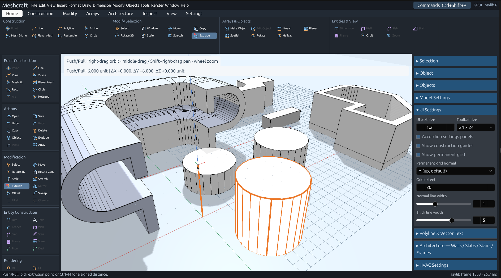
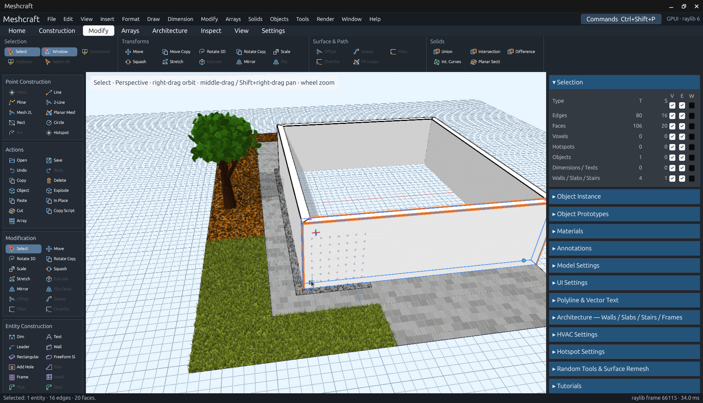
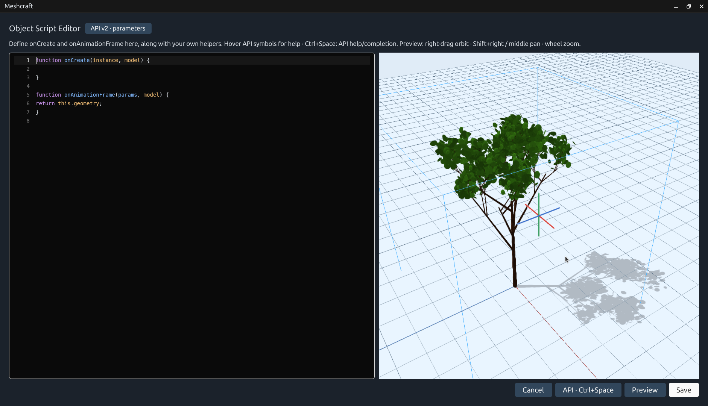

# Meshcraft
[](https://github.com/alfu32/meshcraft/actions/workflows/distribution.yaml)
Meshcraft is a **direct mesh modeler** for building and editing 3D geometry. Draw edges and faces, shape them with modeling tools, and assemble reusable objects whose instances can adapt independently through interactive hotspots.


[](https://snapcraft.io/meshcraft)




The desktop workspace combines a 3D viewport with menus, labeled tool buttons, a searchable command palette and settings panels. Meshcraft is written in Rust, with a GPUI interface and an offscreen raylib renderer integrated into the layout.

Agents can control the running app through its built-in **MCP server**. Start it in the MCP Server
settings panel, then connect to `http://127.0.0.1:8765/mcp`. It publishes live command schemas,
scene/selection data and the complete scripting API, and supports one-shot geometry scripts.
See the [MCP guide](docs/mcp.md).



Object Prototypes include cached isometric thumbnails and editable IFC4.3 creation
defaults. Object Instance properties retain independent IFC values, including
script-declared metadata. The complete offline standard property/quantity catalog
is available in the editor and MCP, with small opt-in Wall/Slab/Door/Window
Common presets; see [IFC properties](docs/ifc-properties.md).
Model surfaces use catalog materials. Material and hotspot color pickers offer
HSL, RGB and swatches, each with opacity controls.

## Modeling tools


- **Draw geometry:** lines, polylines with straight and curved segments, rectangles, circles, planar meshes and 3D primitives.
- **Shape meshes:** extrusion and Push/Pull, sweeps, ribbons, revolve, offsets and outlines.
- **Transform and repeat:** move, rotate, scale, squash along a picked axis, stretch, move a copy, rotate a copy and arrays; reverse face normals and segment direction with Flip.
- **Work precisely:** geometry and grid snapping, construction guides, workplanes, live geometry previews, and relative distance and coordinate feedback.
- **Control selection and display:** select individual elements, connected geometry or regions; inspect totals and selection counts; set visibility, editability and wireframe display by entity type.
- **Inspect your model:** perspective and orthographic views, orbit, pan, zoom and walkthrough navigation in a shaded viewport with configurable lighting, shadows, antialiasing and model line widths.
- **Annotate designs:** dimensions, text and leaders, with editable labels and sizes.
- **Reuse selections:** system cut/copy/paste with floating wireframe placement, Paste in Place, and Copy as Script for an editable JavaScript geometry snapshot.
- **Build architecture:** draw walls, rectangular or freeform polyline slabs, and owned wall/slab openings. Reshape walls, slab profiles, openings and frames with handles, join wall endpoints with Autojoin, and place independent windows and doors without automatic wall cuts. See the [architecture workflow and example](docs/architecture.md).
- **Procedural trees:** GPU-generated branches and foliage with editable prototype/instance settings, seeds, wind and distance-based detail. See the [shader presets guide and example](docs/procedural-presets.md).
- **Materials:** create named RGBA materials and assign them to selections. Procedural materials generate grass, foliage, water, brick, wood and custom surface effects on the GPU, with editable parameters, independent assignment values, wind, textures and PBR bases. See the [procedural material guide and example](docs/procedural-materials.md). Conventional viewport textures and shading interpolation remain future rendering work.
- **Exchange geometry:** import and export OBJ, STL, ASCII FBX, glTF/GLB, Collada, DXF, 3MF, AMF and IFC proxy geometry. Export the selection or full model, with physical units and background jobs. See [supported subsets and workflows](docs/interchange.md).
- **Keep working:** save and load projects, open legacy `.octd` and `.k3d` designs, and undo or redo edits.

## Dynamic objects: prototypes and instances

An **object prototype** is a reusable subscene containing edges, faces, hotspots and other object instances. An **instance** places that prototype in your design. Multiple instances share the same definition while retaining their own placement and hotspot values.

Double-click a prototype in the object list to place an instance, with a wireframe preview before insertion. Double-click an instance to edit its prototype in place. During editing, the surrounding model stays visible and available for snapping, while selection and edits remain isolated to the prototype. Changes to the shared definition update its instances.

**Hotspots make instances interactive.** Inside a prototype, attach geometry to a hotspot and configure its operation, reference point, shape and color. After leaving prototype editing, drag the hotspot on an instance to move, stretch, scale, rotate or repeat its attached geometry. Each instance keeps its own values, so instances can take different forms while sharing the same base topology. Copying an instance preserves its hotspot values.

External scenes can also serve as referenced prototypes, allowing reusable designs to live in separate project files.

## Scripted prototypes

Prototypes can also define JavaScript `onCreate` and `onAnimationFrame` hooks while retaining graphically authored geometry. The object script editor provides a single monospace code editor, Ctrl+Space API help/completion, and an orbitable preview. Geometry helpers create lines, faces and primitives; generated hotspots change each instance independently. Copies retain instance properties, and Explode freezes the current generated geometry.



Scripts can declare `$TEXT`, `$NUMBER`, `$CHECKBOX`, `$LIST` and `$HOTSPOT` model parameters.
Object Properties renders shared prototype controls and independent instance controls. API v2
supplies their current values through `onAnimationFrame(params, model)`. See the
[parameter guide](docs/script-parameters.md).

See the [SDK, example and runtime requirements](docs/rewrite/spec/scripted-objects.md). Native script execution currently requires JavaScriptCore; Linux is locally qualified, with Windows runtime packaging and macOS live qualification still outstanding.

## Planned features

Meshcraft is under active development. The following capabilities are planned; they are not yet complete in the current application:

- **JavaScript plugins:** extend the application through a JavaScriptCore runtime and a versioned application API.
- **More architecture tools:** stairs, additional architectural editing controls, and plumbing and ventilation tools.
- **Photorealistic rendering:** offline rendering for presentation images, complementing the interactive shaded viewport.
- **Vector annotations:** glyph-based vector text and additional annotation presentation options.

The [development dashboard](DASHBOARD.md) tracks implemented behavior, validation and remaining work. The [rewrite guide](docs/rewrite/README.md) links the detailed specifications, architecture and implementation plan.

## Run from source

With Rust and the native build dependencies installed:

```sh
env -u WAYLAND_DISPLAY cargo run -- --open examples/dynamic-object.octd
cargo test --workspace --locked
```

The command above starts the main GPUI application with an example dynamic object. On Linux, unsetting `WAYLAND_DISPLAY` selects the X11 path used for desktop validation.

## Builds and releases

The manual [release workflow](.github/workflows/distribution.yaml) targets Linux, Windows and macOS on x86_64 and ARM64. Select an existing version tag to run it; the tag must match the desktop app version. See [packaging instructions](packaging/README.md) for portable archives, installers, native dependencies and platform qualification status. MSIX signing is planned for a later stage.
