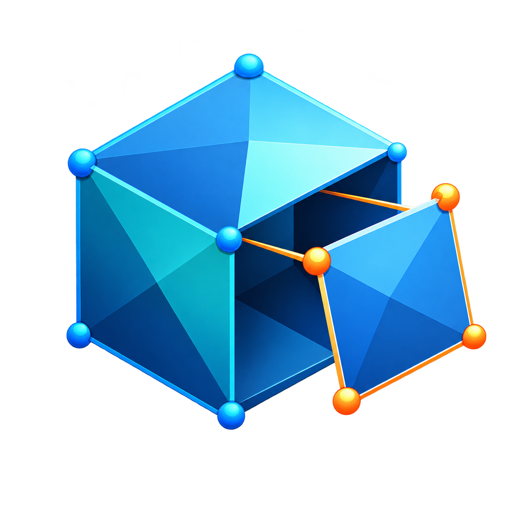
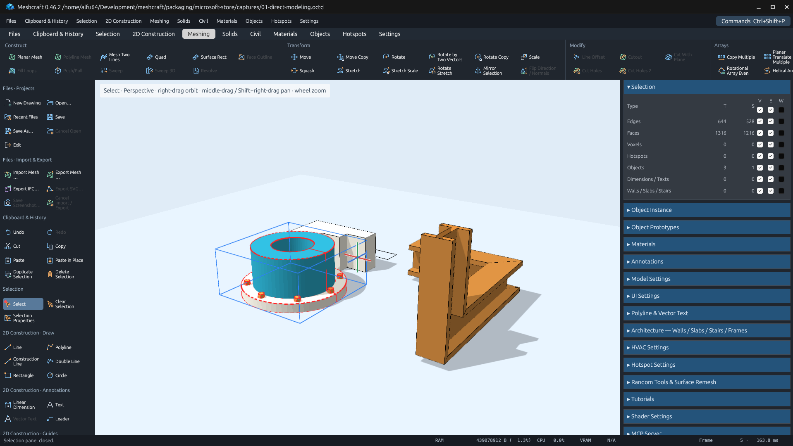
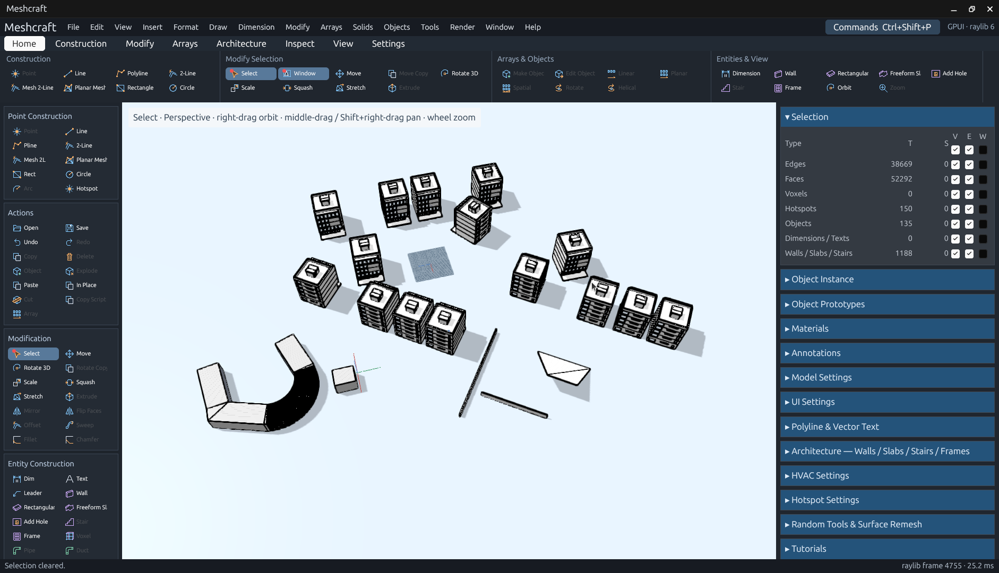
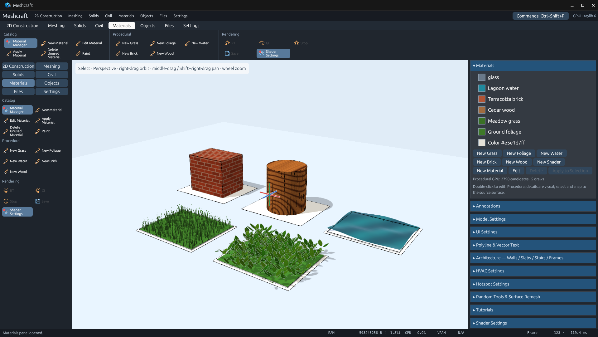
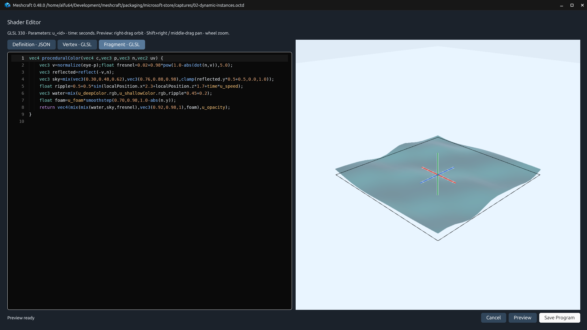

<p align="center">
  
</p>

# Meshcraft

**Draw it. Shape it. Make it reusable.**

Meshcraft is a free, open-source **direct mesh modeler**. Build with edges and faces,
reshape geometry in the viewport, and turn your work into dynamic objects with
independent instances. Use it as a hands-on modeler, or create geometry with
JavaScript and connect an agent through MCP.

[](https://github.com/alfu32/meshcraft/actions/workflows/distribution.yaml)
[](LICENSE-MIT)

**[Download the latest release](https://github.com/alfu32/meshcraft/releases/latest)** ·
**[Try the example drawings](examples)** ·
**[Scripting guide](docs/script-parameters.md)** ·
**[MCP guide](docs/mcp.md)**

[](https://snapcraft.io/meshcraft)

Linux release downloads include **DEB and RPM packages for amd64 and ARM64**, plus
AppImage, Snap and portable archives. See the [installation notes](packaging/README.md#native-deb-and-rpm-packages).



## A workshop for geometry

Draw lines, curved polylines, rectangles, circles and planar meshes, then build
volume with **extrusion, Push/Pull, sweeps, ribbons and revolve**. Move, rotate,
scale, squash, stretch and mirror; repeat geometry with copy tools and arrays.
Union, difference, intersection, planar sections and loop filling help turn
linework and meshes into more complex forms.

Snapping, cursor-aligned guides, numerical distances and coordinates, and live
wireframe previews support precise work. Flip reverses face normals and segment
directions. Perspective, orthographic and walkthrough cameras let you inspect
what you build, while dimensions, text and leaders annotate it.

Menus, ribbon tabs and the left tool panel start with **Files, Clipboard & History
and Selection**, followed by **2D Construction, Meshing, Solids, Civil, Materials,
Objects, Hotspots and Settings**.
Each visible action has one home per surface; a searchable command palette
retains every registered command. Set visibility, editability and wireframe display by entity type, or
show only the UI sections you need. Meshcraft is written in Rust, with a GPUI
interface and a raylib viewport using persistent GPU meshes and shared instances.

## Model once, vary each instance

A **prototype** is a reusable subscene containing edges, faces, hotspots and other
object instances. Place it repeatedly with a wireframe insertion preview, then
edit its shared definition in place. Surrounding geometry remains visible for
snapping while editing stays isolated to the prototype.

**Hotspots make instances dynamic.** Configure operations and attached geometry
inside the prototype; after leaving edit mode, drag an instance's hotspots to
change its shape. Each instance keeps its own values. Copies retain them, and
external scenes can supply referenced prototypes.

**Bake to Shader** freezes evaluated objects as static GPU meshes. **Bake to Mesh**
turns frozen or shader-generated objects into editable edges and faces, with Undo.
[Object conversion details](docs/rewrite/spec/objects.md#bake-to-shader-and-bake-to-mesh).



Prototype thumbnails help browse your library. Prototype and instance properties
also support editable **IFC4.3 metadata**, with an offline standard property and
quantity catalog and optional common building-element presets.
[Explore IFC properties](docs/ifc-properties.md).

## Objects you can program

Combine graphically modeled geometry with JavaScript, or generate an object
entirely from code. Define `onCreate` and `onAnimationFrame` in one script, declare
controls with **`$TEXT`, `$NUMBER`, `$CHECKBOX`, `$LIST` and `$HOTSPOT`**, and read
current parameter values in the frame hook. Controls can belong to the shared
prototype or to an individual instance.

The object editor combines a monospace, highlighted code editor with an orbitable
preview. **Ctrl+Space** discovers the injected API; hover descriptions explain
its functions and identifiers. Geometry helpers, transforms and primitives are
available in scope. Explode freezes the currently generated geometry into editable
model elements. **Copy as Script** turns a selection into a starting point for code.


Start with the [parameter guide](docs/script-parameters.md),
[SDK and runtime requirements](docs/rewrite/spec/scripted-objects.md), or
[example drawings](examples).

## Architecture with editable geometry

Build **walls, rectangular and freeform slabs, openings, windows, doors and stairs**.
Join walls with Autojoin; reshape profiles and heights with handles. Slab vertices
can have different elevations for roof-like forms. Openings belong to their wall
or slab; windows and doors remain independent elements.

Stairs take a planar contour and a walking path, with editable height, steps,
support thickness, and left/right guardrail guide levels. Architectural elements
retain material assignments and can be exploded into ordinary mesh geometry.


[Architecture workflow and stair example](docs/architecture.md).

## Materials that bring a model to life

Create named materials, choose colors with **HSL, RGB, swatches and opacity**, and
apply them to selections or architectural surfaces. Procedural **grass, foliage,
water, brick and wood** materials add GPU-generated surface effects. Procedural
**trees** provide editable shape, seed, wind and distance-based detail.

| Procedural tree | Surface foliage |
| --- | --- |
|  |  |

Custom shader materials have a spacious editor with **Definition, Vertex and
Fragment tabs**, JSON/GLSL syntax highlighting and a separate GPU preview.



[Material guide](docs/procedural-materials.md) ·
[Tree, foliage and surface presets](docs/procedural-presets.md).
Procedural details are visual: selection and snapping use their source surface or
owner, and mesh exports omit generated detail. Conventional texture sampling and
shading interpolation remain future rendering work.

## Open workflows

- **Exchange geometry:** import and export OBJ, STL, ASCII FBX, glTF/GLB, Collada,
  DXF, 3MF, AMF and IFC proxy geometry. Export a selection or the whole model.
  See [supported subsets](docs/interchange.md).
- **Keep your work:** save projects, reopen legacy `.octd` and `.k3d` drawings,
  undo/redo edits, and use cut/copy/paste with floating placement or Paste in Place.
- **Connect an agent:** start the built-in MCP server from its settings panel.
  It publishes live command schemas, scene and selection data, scripting API
  signatures and descriptions, and accepts one-shot scripts through that API.
  The default endpoint is `http://127.0.0.1:8765/mcp`.
  See the [MCP guide](docs/mcp.md).

## What's next

Meshcraft is under active development. Planned work includes **JavaScript plugins**
with a versioned application API, more architectural and building-services tools,
**photorealistic rendering**, richer vector text and annotations, and broader
platform qualification.

## Performance reports

The [performance suite](docs/performance/README.md) exercises every tool at four
model sizes, including bulk selection, Move and Rotate. Run **Stress test** after
**Release** at the same tag to publish the
[latest release performance report](https://github.com/alfu32/meshcraft/releases/latest/download/performance.md),
[CSV](https://github.com/alfu32/meshcraft/releases/latest/download/performance.csv) and
[raw samples](https://github.com/alfu32/meshcraft/releases/latest/download/performance.json).
A new release gets these assets when its stress run finishes; failures and
unsupported commands remain visible. See the guide for measurement limits.
Benchmark outcomes are non-gating. Interrupted runs publish an explicit incomplete
report and [all available diagnostics](https://github.com/alfu32/meshcraft/releases/latest/download/performance-diagnostics.zip).

The [local 0.40.0 qualification](docs/performance/local-0.40.0/performance.md)
contains the first complete four-tier ledger. It uses a development binary and
one sample per case; it exposes failures and is not a release-speed claim.

The [tool inventory CSV](docs/tools/tools.csv) records current command placement
and preserves your review columns. See the [functional layout](docs/menu-layout.md)
and [review instructions](docs/tools/README.md) to propose refinements.

The [development dashboard](DASHBOARD.md) records implementation and validation.
The [rewrite guide](docs/rewrite/README.md) links specifications, architecture and
remaining work. Screenshots above are actual application captures; their
[manifest](docs/screenshots/manifest.json) records their live MCP sources and
the completed menu-redesign refresh.

## Build and run

With Rust and the [native build dependencies](packaging/README.md) installed:

```sh
env -u WAYLAND_DISPLAY cargo run -- --open examples/dynamic-object.octd
cargo test --workspace --locked
```

On Linux, unsetting `WAYLAND_DISPLAY` selects the X11 path used for desktop
validation. Read-only command discovery also works without a display:

```sh
cargo run -- --command-catalog
```

The manual [release workflow](.github/workflows/distribution.yaml) targets Linux,
Windows and macOS on x86_64 and ARM64. Select an existing version tag; it must
match the desktop app version. See [packaging and platform qualification](packaging/README.md)
for portable archives, AppImage, Snap, MSI, MSIX and DMG. MSIX signing is deferred.

Meshcraft is licensed under [MIT](LICENSE-MIT) OR [Apache-2.0](LICENSE-APACHE).
Third-party asset notices retain their respective terms.

Read the [Privacy Policy](docs/PRIVACY_POLICY.md) for data storage, network access and privacy contact details.
