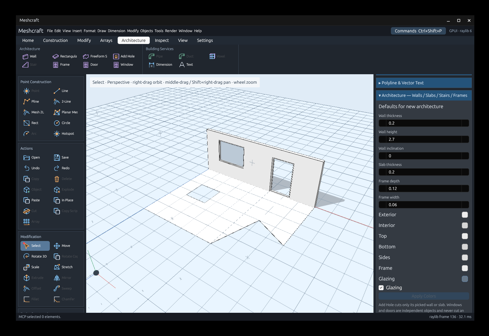
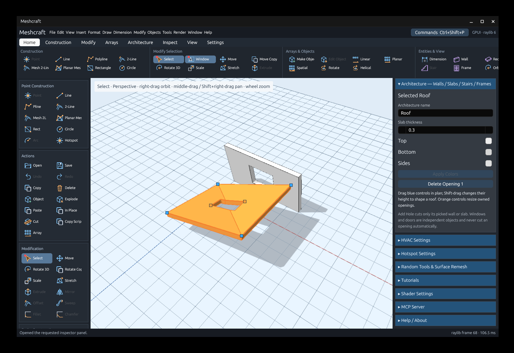
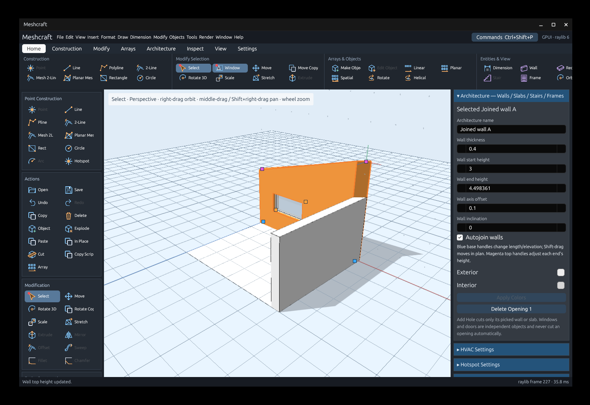
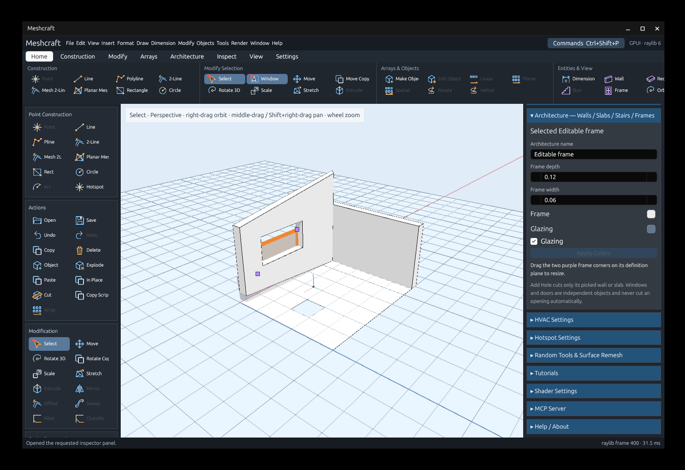

# Architecture tools

The Architecture ribbon contains Wall, Rectangular Slab, Freeform Slab, Add Hole,
Window and Door. The Architecture settings panel edits the selected element, or
sets defaults for new elements when nothing is selected.



- **Wall:** pick the first endpoint and subsequent chain points. Each span commits
  separately; Enter ends the chain. Thickness, independent start/end heights,
  signed axis offset, inclination and exterior/interior colors are editable.
  Autojoin is enabled by default: compatible walls sharing a baseline endpoint
  join when both owners enable it. Disabling either one regenerates their ends.
  Zero offset centers the wall on its axis; positive offset moves it toward its
  exterior normal.
- **Rectangular Slab:** pick two opposite corners. It creates a four-point closed
  polyline slab, using the picked surface/workplane normal.
- **Freeform Slab:** pick the boundary points, then press Enter or close onto the
  first point. A/C/L select the existing arc/circular/line path modes. A selected
  closed polyline can also supply the boundary directly.
- **Add Hole:** pick two opposite opening corners on a wall or slab. The first
  pick locks the owner; the hole belongs only to that element. The panel lists
  its openings and provides individual deletion buttons.
- **Window / Door:** pick two opposite frame corners, or use a selected closed
  contour. Each placement is an independent object with its own prototype.
  Dimensions, frame color and optional glazing are editable. These tools never
  create a wall/slab hole automatically; use Add Hole explicitly. The initial
  frame plane takes its normal from the cursor’s **blue up vector**, including
  endpoint/line snaps (which can have a different snap normal).

Select a slab to show its blue profile controls. Drag a control freely in 3D,
with the same movement whether Shift is held or not. Geometry and guide snaps
supply precise positions, including the ground grid. Without a snap, movement
follows a plane parallel to the active grid through the grabbed control, preserving
its elevation. An edge-on grid uses a view-plane fallback so controls remain
draggable. The dragged owner's own solid is excluded from snapping. An orange wireframe shows the future shape with
relative-distance feedback. The solid model stays unchanged during dragging;
releasing commits one undoable edit, and Escape discards the preview. Existing openings retain their plan positions
and follow the roof’s height
while its outline changes. Invalid/self-intersecting plan outlines are rejected.
Profile points can have different heights: the roof is triangulated through them.
Sides and opening reveals stay parallel to the extrusion axis. A planar sloped
roof retains the specified normal thickness; at folds the continuous underside
maintains at least that thickness, allowing a thicker join.



Try [the roof example](../examples/architecture-roof.octd) to edit a warped slab
and an inclined, offset wall with owned openings.

Wall/slab selections operate on canonical elements rather than generated facets.
Move, copy, arrays and clipboard placement retain their profiles and owned holes.
Windows/doors retain ordinary object placement/prototype editing behavior.
Explode materializes an object's current architecture geometry as ordinary mesh.
It also works directly on selected walls or slabs, replacing their canonical
parameters with their currently realized lines and triangles.

## Wall, opening and frame controls

Select one or several architectural elements to expose their controls:

- **Blue wall bases:** the start is a square and the end is a circle. Both move
  using 3D geometry/guide snaps and the ground grid. Without a snap they move
  parallel to the active grid at their original elevation.
  Shift does not change the movement. Moving a base preserves that end's height,
  so its top moves with it. All four wall controls stay on the wall axis plane,
  independently of axis offset or inclination.
- **Magenta wall top triangles:** adjust each end's height independently of its
  base and the opposite end. Both bottom and top edges can slope.
- **Orange opening corners:** resize each wall/slab hole using two opposite
  corners on the owner's definition plane.
- **Purple frame corners:** resize the complete planar contour between opposite
  bounds, keeping its border width and depth.

Wall/slab wireframes show boundary, reveal and roof-fold edges, without internal
tessellation lines or a grid dividing wall faces around openings.

Wheel zoom supports **Ctrl for one-tenth speed** and **Alt for one-twentieth speed**;
Alt takes precedence when both modifiers are held.

Axis and grid guides keep the full cursor alignment when placed: red, green and
blue become the guide’s U, V and W axes. This includes blue following a snapped
segment. **G** places a grid guide and **T** an axis guide at the cursor.

Every drag previews only the owner's future boundary/reveal wireframe, shows
relative feedback, commits once on release, and supports Escape, Undo and Redo.
Previewing does not clone the full document, regenerate neighboring walls or
replace the solid scene. Wall joins are regenerated when the edit is committed. Visibility/editability and prototype context
still apply.





Legacy import preserves inner-face wall axes through a half-thickness offset and
maps lower-face slab definitions to the canonical top profile. Its opening UVs
already use the normalized plane basis; they are retained without another flip.

[The controls example](../examples/architecture-controls.octd) contains joined
walls, unequal base/top levels, an offset, wall/slab openings and independent
frames with two different normals.

Open [the example project](../examples/architecture.octd) with:

```sh
cargo run -- --open examples/architecture.octd
```

Automation uses the same commands; see [the MCP guide](mcp.md#architecture).

## Internal values and displayed measurements

Numeric settings stay in internal units. Beside each architecture length input,
the panel shows its converted measurement: internal length × Unit size, followed
by Unit name. Inclination is in degrees and is not converted. This applies both
to defaults and selected elements. For Unit name `cm`, Unit size `30` and Grid
size `0.5`, one grid step measures `15 cm`; a wall thickness input of `0.5`
also shows `15 cm`. Geometry, numeric tool entry and saved coordinates are unchanged.

The architecture inspector groups properties into **Walls**, **Slabs** and
**Frames** subsections. Each uses aligned Property / Value / Measured columns;
labels are shortened to Thickness, Start height, End height, Axis offset,
Inclination, Depth and Width. Value fields are plain editable inputs, without
increment/decrement buttons or a generic “units” suffix. Measured retains the
configured unit label; inclination shows degrees. Colors, Autojoin and glazing
stay with their corresponding subsection. Selected elements show only their
own subsection. Enter or leaving a field commits through the existing validation.
