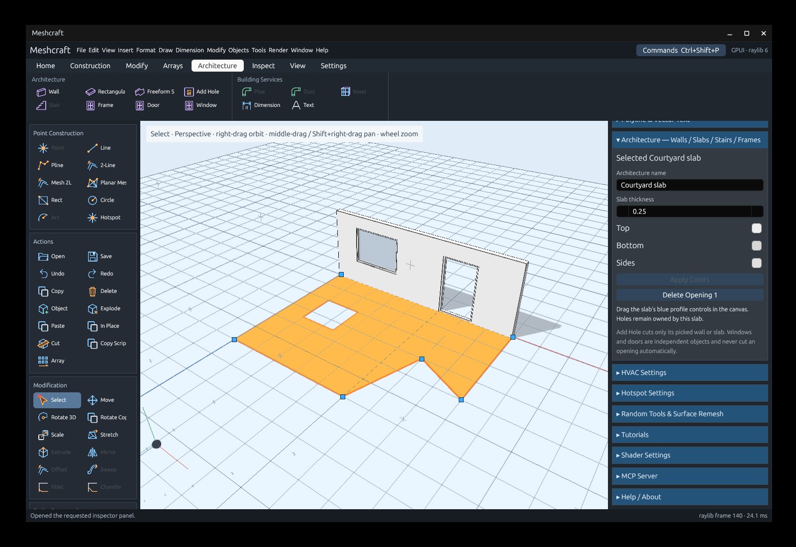

# Architecture tools

The Architecture ribbon contains Wall, Rectangular Slab, Freeform Slab, Add Hole,
Window and Door. The Architecture settings panel edits the selected element, or
sets defaults for new elements when nothing is selected.


- **Wall:** pick the first endpoint and subsequent chain points. Each span commits
  separately; Enter ends the chain. Thickness, height, inclination and exterior/
  interior colors are editable in the panel.
- **Rectangular Slab:** pick two opposite corners. It creates a four-point closed
  polyline slab, using the picked surface/workplane normal.
- **Freeform Slab:** pick the boundary points, then press Enter or close onto the
  first point. A/C/L select the existing arc/circular/line path modes. A selected
  closed polyline can also supply the boundary directly.
- **Add Hole:** pick two opposite opening corners on a wall or slab. The first
  pick locks the owner; the hole belongs only to that element. The panel lists
  its openings and provides individual deletion buttons.
- **Window / Door:** pick two opposite frame corners, or use a selected closed
  contour. Each placement is an independent object with its own prototype.
  Dimensions, frame color and optional glazing are editable. These tools never
  create a wall/slab hole automatically; use Add Hole explicitly.

Select a slab to show its blue profile controls. Drag a control on the slab plane
with live geometry and relative-distance feedback. Releasing commits one undoable
edit; Escape cancels the preview. Existing openings retain their positions while
its outline changes. Invalid/self-intersecting outlines are rejected.



Wall/slab selections operate on canonical elements rather than generated facets.
Move, copy, arrays and clipboard placement retain their profiles and owned holes.
Windows/doors retain ordinary object placement/prototype editing behavior.
Explode materializes an object's current architecture geometry as ordinary mesh.

Open [the example project](../examples/architecture.octd) with:

```sh
cargo run -- --open examples/architecture.octd
```

Automation uses the same commands; see [the MCP guide](mcp.md#architecture).
