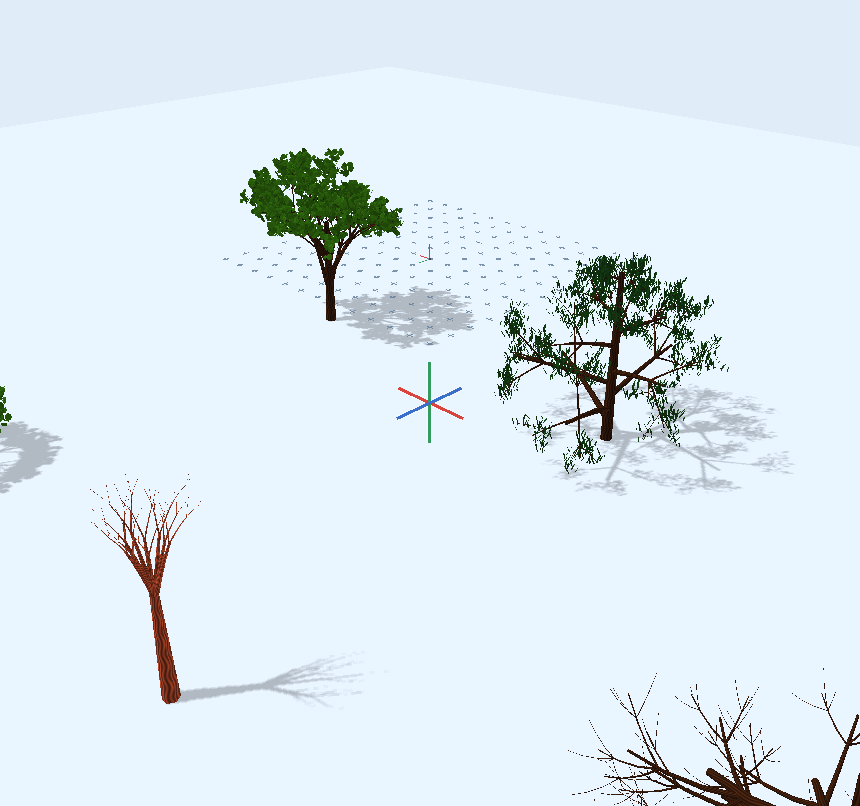

# Branching shaders — #29 / #31

**New Tree** uses `meshcraft.branching.v1`, a single GLSL branching engine with
Broadleaf, Conifer, Weeping, Shrub, Coral and Roots rule families. Pick **Form** in
the procedural object editor; its right-hand preview shows the effective draft.
All families share one evaluator. Old `meshcraft.tree.v1` objects retain their
original program and appearance; selecting the new program is an explicit change.

[Open the six-family example](../examples/branching-families.octd).



[Object settings with a live preview](rewrite/references/branching-shaders/settings.png).

Only program definitions, parameters, seeds and ordinary object placements are
stored. Rust computes candidate counts and bounds. Branch transforms, attachment
points, quadratic curves, tapered tubes, foliage positions, pruning, growth and
wind are computed in the vertex shader. There is no CPU-generated branch mesh or
CPU substitute for the shader. **Bake to Mesh** explicitly reads back that shader
at its current animation time; normal modeling/rendering does not read it back.

## Model and identity

The user's universal-branching proposal motivates a conditional recursive model:

\[
 B_{k+1}=\bigcup_{b\in B_k}\bigcup_{j=0}^{m_k-1} F_j(b,P,\xi_b).
\]

A child attaches to its parent's quadratic curve. Its frame follows the parent's
tangent, then applies a local azimuth/deflection, length/radius scaling and
tropism. The implementation reconstructs these steps from child-slot ancestry in
a bounded GLSL loop; it does not build an authored intermediate scene graph.
A transform-feedback state pass evaluates each branch once per draw and stores
four RGBA32F texels (64 bytes) in a reusable GPU buffer. Tube and leaf shader
instances sample that buffer. This avoids repeating ancestry reconstruction for
every emitted vertex. No state buffer is mapped or read back during rendering;
explicit baking uses the same direct evaluator without the cache. Slot zero
through the configured arity identify siblings. A two-word unsigned path starts
at `(1,0)` and appends `child+1` in four-bit digits (`x` low, `y` high). Randomness
is a deterministic hash of this path and the object seed.

Draw ordinals enumerate paths breadth-first. Changing budgets or submitting more
siblings does not change an existing path's identity or random samples. Ancestors
precede descendants, so truncating the draw prefix cannot create orphan limbs.
Family rules may intentionally use sibling count for layout, such as conifer
whorl spacing; stable identity does not mean all parameter changes leave geometry
unchanged.

This is a finite conditional branching framework, not an infinite dendrite or a
Mandelbrot slice. Its ancestry is acyclic, but geometry can intersect. It does not
simulate plant competition, collisions, hydraulics or constrained biological
growth, and a fixed finite parameter family does not represent every possible
finite topology. The editable shader rule provides more control within the
backend's explicit limits.

## Controls

- **Form** selects a rule family. Coral and Roots omit leaf cards; conifers use
  narrow needles and weeping trees have pendant leaves.
- **Height / Crown radius** define the local vertical/radial envelope. Roots
  invert the vertical direction. The mesh is clipped to this envelope before
  tube radius, leaves and wind are added; conservative owner bounds include them.
- **Primary branches / Children per branch / Branching depth** determine the
  candidate topology. Depth zero emits only the trunk, plus optional foliage.
- **Branch angle / Phyllotactic angle / Attachment** set deflection, azimuth and
  parent-curve attachment. UI angles are degrees; shader rule angles are radians.
- **Length ratio / Radius ratio / Curvature / Tropism / Variation** control
  inherited geometry and deterministic variation.
- **Growth** introduces levels progressively by scaling lengths/radii from zero.
  **Branch survival** smoothly activates seeded subtrees, with survival inherited
  by descendants. Zero survival leaves the trunk; zero growth emits no surface.
  These transitions are continuous. Integer arity/depth edits are discrete.
- **Branch LOD** fades subpixel hierarchies in screen pixels, inherited by
  descendants; zero disables it. The existing LOD distance thins foliage.
- Leaf budget/size, wind, bark/leaf color, base material, candidate budget and
  instance/prototype override behavior retain the standard object settings.

The GL 3.3 backend permits depth **0–6**, **1–12** primary branches and **1–8**
children per branch. At most **16,384 branch candidates** are submitted per object,
further limited by its candidate budget; foliage uses the remaining budget.
Each branch has three curved longitudinal sections and six radial sectors
(36 triangles / 108 vertices); each leaf is a two-triangle masked card. Candidate
limits include pruned branches, so pruning cannot increase the work bound. GPU
ancestry traversal terminates early for dead subtrees. Full-detail mesh baking
bypasses camera LOD and retains the existing two-million-triangle readback limit.
Leaves remain cards in a baked mesh, as with legacy trees.

## Editable GLSL hook

Open **Edit Program / Parameter Schema** to copy/edit a program. Its Vertex tab
contains the same hook for every family:

```glsl
void branchingRule(inout BranchRule rule, int level, int child,
                   uvec2 path, uint key) {
    // Suppress some descendants, with no CPU topology generation.
    if (level > 2)
        rule.activation *= smoothstep(0.2, 0.8, random(key));
}
void proceduralVertex(inout vec3 position, inout vec3 normal, vec2 uv) {
    // Optional deformation after the common branch/leaf evaluator.
}
```

| `BranchRule` field | Meaning / enforced range |
| --- | --- |
| `attach` | Parent curve parameter, 0–1 |
| `angle` | Deflection from parent tangent, radians, 0–π |
| `azimuth` | Rotation around parent tangent, radians |
| `lengthScale` | Parent chord length multiplier, 0–2.5 |
| `radiusScale` | Parent attachment radius multiplier, 0–0.95 |
| `bend` | Quadratic curvature, −1–1 |
| `tropism` | Local vertical attraction, −1–1 |
| `activation` | Continuous child survival, 0–1; inherited |

The rule also carries read-only `parentStart`, `parentControl`, `parentEnd`,
`parentFrame` and `parentRadius` values in local coordinates. They allow
position/radius-dependent branching and termination; writes to these fields are
ignored by the evaluator.

The hook runs after family/default rules at levels 1–6. `child` is zero-based.
`hash(uint)`, `random(uint)`, `u_<parameter>` uniforms and `time` are available.
The source object remains editable by parameters; previews, shadow/depth passes
and bake capture share the evaluator and hook. Arbitrary custom deformation can
exceed the built-in envelope and needs appropriate program bounds; invalid output
is rejected by bake capture. A custom time-dependent program must request animation.

MCP publishes the program, typed parameter signatures/descriptions, hook source,
`branchingLimits` and `ruleFields` through `meshcraft_scene` and its shared resource
interfaces. `object.configure_procedural` accepts the normal Material-shaped
settings with `procedural.program = "meshcraft.branching.v1"`. Prototype defaults,
private instance overrides, copy/paste and project persistence use the existing
object workflow. No new command IDs or separate scripting runtime are needed.
