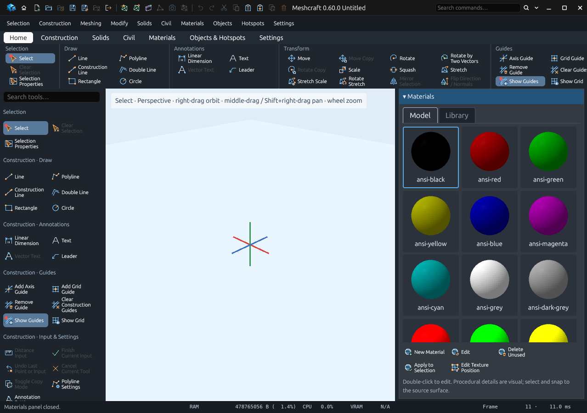
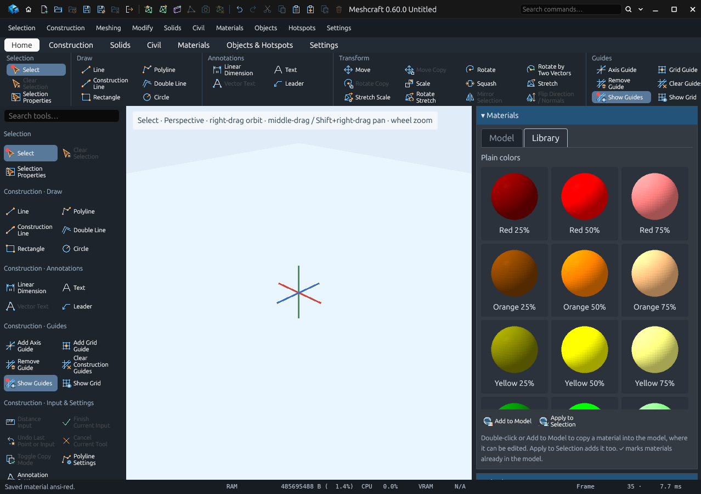
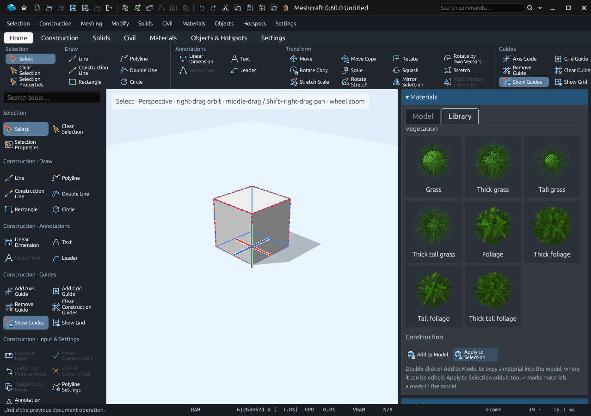
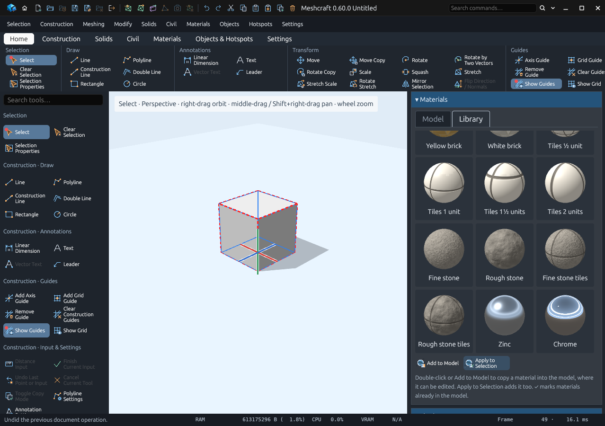

# Materials panel and material library (T84)

Since 0.60.0 the **Materials** panel shows every material as a small sphere
wearing it, with the name underneath. It has two tabs:

- **Model**: the materials in the open model.
- **Library**: ready-made materials that ship with Meshcraft, grouped in sections.

## Model tab

Click a material to make it current. Double-click it to edit. **New Material**,
**Edit**, **Delete Unused**, **Apply to Selection** and **Edit Texture Position**
work as before.

The pictures are rendered with the same shaders as the viewport, so shader
materials show their bricks, grain, reflections or grass. Editing a material renders
its picture again; until a picture is ready the tile shows a plain colour disc.

## Library tab

- **Double-click** a library material, or select it and press **Add to Model**, to
  copy it into the model. It becomes the current material and an ordinary model
  material that you can edit; the library itself never changes.
- **Apply to Selection** adds the material if needed and applies it to the
  selection, as one Undo step.
- A ✓ marks library materials already in the model. Adding one again does not
  overwrite your edits to the copy in the model; it just makes it current.

**Materials › Library › Add Library Material** and **Apply Library Material** act on
the library material selected in the panel. With none selected they open the
Library tab instead.

### Sections

| Section | Materials |
| --- | --- |
| Plain colors | Red, orange, yellow, green, cyan, blue, magenta and fuchsia at full saturation and 25, 50 and 75% lightness; greys from 0 to 100% in steps of 10% |
| Vegetation | Grass and foliage, each normal, thick (denser), tall and thick + tall |
| Construction | Blue and green glass; red, yellow and white brick; tiles of ½, 1, 1½ and 2 units; fine and rough stone; 1-unit stone tiles, fine or rough; zinc and chrome |

Lightness is HSL lightness: 50% is the pure hue, 25% is darker and 75% lighter.
Magenta is hue 300° (#ff00ff); fuchsia is the pinker hue 330°. "Thick" means
denser blades or leaves; "tall" means longer blades, or leaves larger and higher
above the surface. Tile sizes are in model units, and the joints scale with the tile.
Shader materials use the [standard shaders](standard-shaders.md) and the brick,
grass and foliage presets.

### Library IDs

Library materials keep stable IDs beginning with `library.` once added:

- `library.color.<hue>-<25|50|75>` for `red`, `orange`, `yellow`, `green`, `cyan`,
  `blue`, `magenta`, `fuchsia`; `library.color.grey-<0…100>` in steps of 10.
- `library.grass.normal|thick|tall|thick_tall`,
  `library.foliage.normal|thick|tall|thick_tall`.
- `library.glass.blue|green`, `library.brick.red|yellow|white`,
  `library.tiles.0_5|1|1_5|2`, `library.stone.fine|rough`,
  `library.stone_tiles.fine|rough`, `library.metal.zinc|chrome`.

Over MCP, `material.add_from_library {"id": …}` adds one and
`material.apply_from_library {"id": …}` applies one to the current selection.

## How the pictures are made

Each picture is a sphere rendered off screen by the graphics thread between viewport
frames, with its own renderer so the viewport's prepared scene is untouched. It works
for at most 40 ms at a time, so the viewport keeps drawing while a section fills
in. Pictures are cached by everything that changes the look (the material, its
custom program and base material, and the texture folder), not by name, and only the
pictures of the tab on screen are requested.

Validation: `python3 scripts/verify_materials_panel.py` drives all of the above in
the real application; [T84](rewrite/handoffs/T84.md) records the results.
