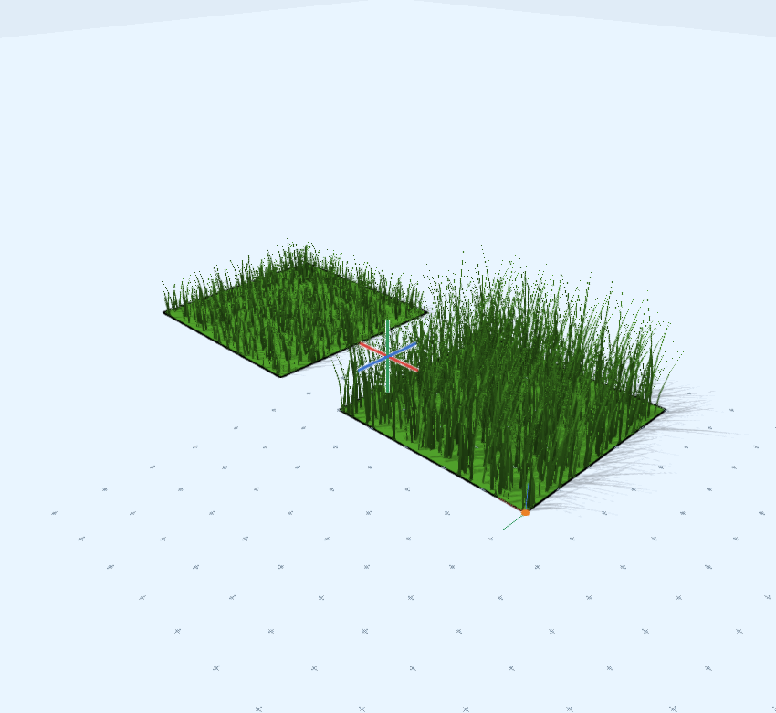
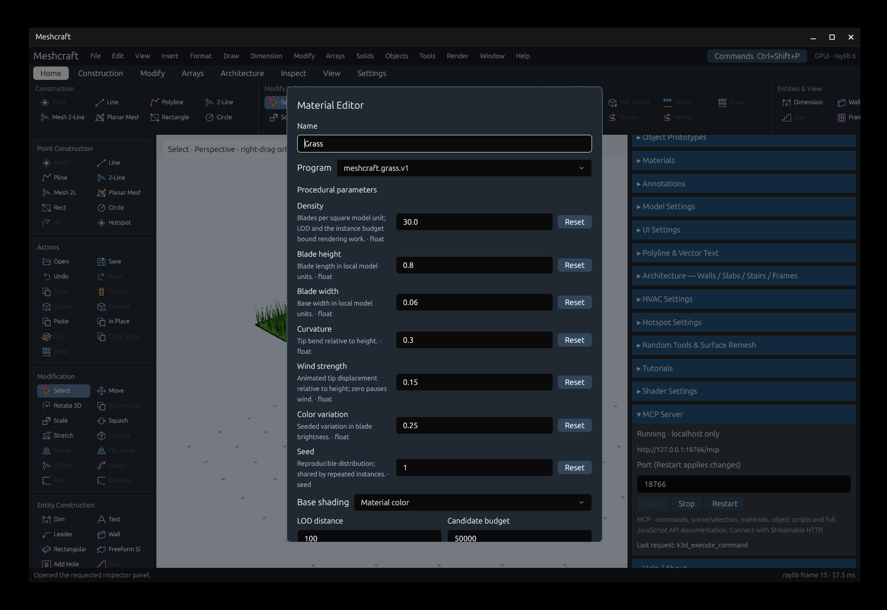
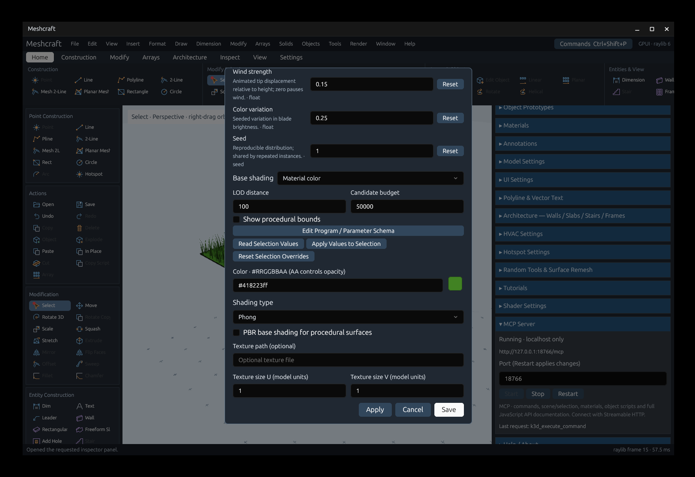
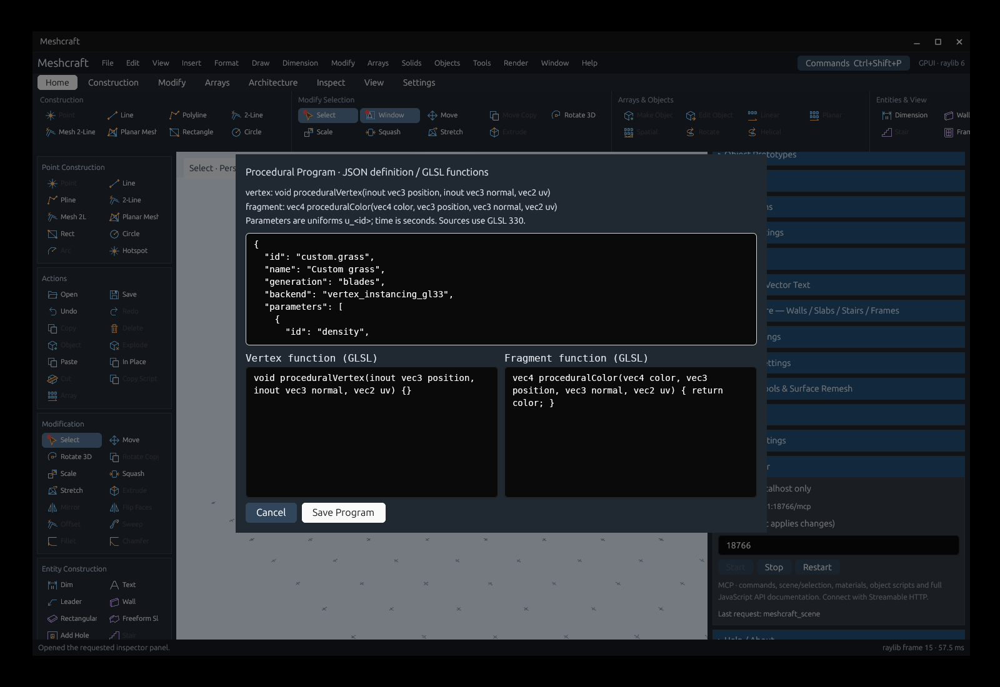

# Procedural materials (#30)

Procedural materials add GPU-generated surface details to ordinary Meshcraft
geometry. Grass, Water, Brick and Wood are included; custom programs can deform/shade a surface or
customize generated strips. Definitions, settings and source surfaces are saved;
generated blades never become editable mesh triangles.



## Create grass

1. Draw or select a surface. In **Materials**, choose **New Grass**.
2. Set the name/color and grass parameters, then Save.
3. Select the material and choose **Apply to Selection**.
4. Double-click its material entry to adjust density, height, width, curvature,
   variation, seed or wind. **Apply** commits and keeps the dialog open; **Save**
   commits and closes it. **Reset** restores a parameter's program default.

Lengths use local internal model units; density is blades per square world model
unit. Seed controls the reproducible distribution. Zero wind pauses the built-in
animation. Changing a seed or parameter reuses the uploaded distribution surface;
no blade mesh is constructed on the CPU. Visibility/wireframe settings still apply.

[Open the example drawing](../examples/procedural-grass.octd) for two surfaces
sharing a material with different assignment values. It contains eight authored
edges and four triangles. The captured view evaluates 3,318 candidate GPU
instances in two procedural draws. Wind is zero in the example so it stays idle.



## Material defaults and selected assignments

Editing a material and using Apply/Save changes its shared defaults. Existing
explicit assignment values retain priority. To change only selected surfaces or
instances, use **Apply Values to Selection**. It reads the form without saving
those values as global material defaults; save a newly created material first.
**Read Selection Values** loads the selected assignment's effective values, or
reports mixed values. **Reset Selection Overrides** restores inheritance.
Architectural assignments retain values when walls/slabs/frames rebuild.

Program defaults, material values and assignment overrides form three separate
layers. These settings use normal Undo/Redo and survive save/reopen, copying
instances and scene import. Selection stays attached to the source geometry;
blades are not snap targets and are not baked by Explode or mesh export.



LOD reduces density with distance. The candidate budget limits work per placement.
If a distribution domain has more triangles than its budget, increase the budget
or simplify the source surface; the inspector reports the condition. **Show
procedural bounds** draws the conservative expanded bounds used for culling.

An optional **Base shading** reference supplies another conventional material's
color/alpha, texture and PBR settings. Enable its PBR base shading to set roughness
and metallic (0–1). Procedural shading uses GGX lighting for PBR bases. Existing
conventional viewport rendering retains its previous behavior. Texture dimensions
are sizes in model units; texture paths are absolute or relative to the working
directory. Missing textures use a white fallback with a diagnostic.

## Custom programs

Use **New Shader**, or **Edit Program / Parameter Schema** in the material editor.
The program editor separates JSON metadata/parameter declarations from monospace
vertex and fragment source fields. Saving a built-in edit creates a custom
program ID; the built-in grass definition remains unchanged. Choose the saved
program in the material's Program list and apply/save that material.



For example, declare a floating-point parameter in the metadata:

```json
{"id":"amplitude","kind":"float","label":"Amplitude","default":0.2,"min":0,"max":1,"description":"Surface displacement in local model units"}
```

Use `generation:"surface"`, `animated:true`, `boundsExpansion:1`, then provide:

```glsl
void proceduralVertex(inout vec3 position, inout vec3 normal, vec2 uv) {
    position += normal * u_amplitude * sin(position.x + time);
}
```

```glsl
vec4 proceduralColor(vec4 color, vec3 position, vec3 normal, vec2 uv) {
    return color;
}
```

Shader source uses GLSL 330. Parameters become uniforms named `u_<id>`; `time` is
seconds. Vertex positions/normals are local; fragment positions/normals are world
space. Metadata supplies defaults, descriptions, units, range/step and enum
choices. Parameter kinds include float, signed/unsigned integer, seed, Boolean,
vectors, RGBA color, matrix, texture path and enum. Boolean controls and enum
choices render as checkboxes/selectors; vectors, colors and matrices accept JSON
arrays. Texture parameters bind samplers. Program authors must declare enough
bounds expansion for custom deformation, and `transparent:true` for blended
fragment alpha. Program Save is a separate explicit document edit; cancelling a
material draft does not undo a program or material already applied/saved.

Compiler/linker logs appear in the Materials panel/editor and in MCP capture
results. Missing programs, unsupported backends and failed shaders preserve the
source's conventional fallback appearance. The native renderer uses OpenGL 3.3
vertex instancing. Compute/mesh shader generation and independent procedural
objects (tree/bush) are later work under #29/#31. Generated details are visual-only.

The [MCP guide](mcp.md#procedural-materials-30) documents program/material/assignment
commands and their discovery schemas. [T63 validation](rewrite/handoffs/T63.md)
records tested behavior and platform limits.

See [Shader presets and tree objects](procedural-presets.md) for the additional creation actions, controls and limitations.
