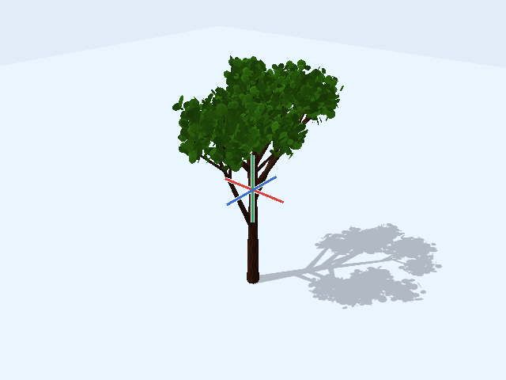
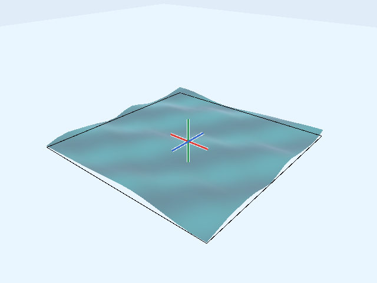
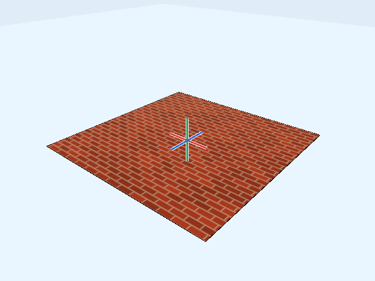
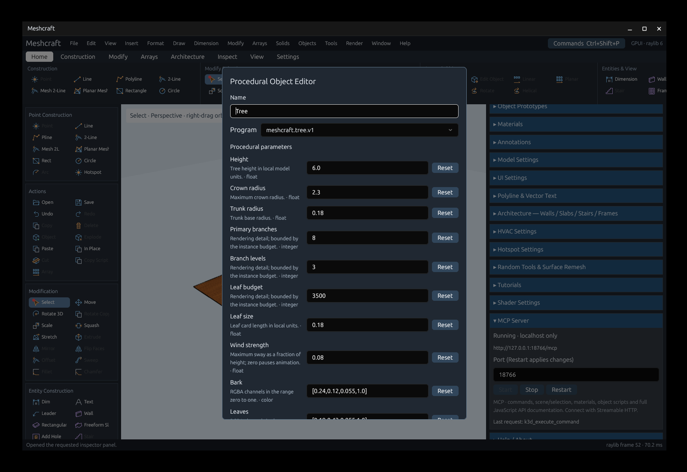

# Shader presets and tree objects — #29/#31

All dimensions are local internal model units. These are GPU visuals: only the
source surfaces, object settings and seeds are saved, not generated mesh data.

| Tree | Water |
| --- | --- |
|  |  |
| Brick | Wood |
|  |  |

[Open the example drawing](../examples/procedural-presets.octd) for three surface
materials and two tree instances with different settings.

## Water, brick and wood

In **Materials**, choose **New Water**, **New Brick** or **New Wood**, adjust its
parameters, Save, select the source geometry and **Apply to Selection**.
Double-click the material to edit shared defaults. The existing **Apply Values
to Selection** action changes only the selected assignments.

- **Water:** wave height, wavelength, direction, speed, mean surface offset,
  subdivision detail, opacity, shallow/deep colors and crest foam. Set speed or
  wave height to zero to stop animation. Subdivision is generated on the GPU and
  capped by the candidate budget. The default offset keeps the waves above a
  source at display-ground level; change it for other source surfaces. Fresnel
  uses an approximate sky color, not scene reflections, water depth or refraction.
- **Brick:** brick width, course height, mortar fraction, alternating-course
  stagger, variation, seed, brick/mortar colors and shading relief. Dominant-face
  local projection preserves patterns across a coplanar surface's triangles.
- **Wood:** growth-ring frequency, grain frequency, distortion, longitudinal
  axis, light/dark colors, seed and shading relief. It is a solid-coordinate
  pattern: end faces reveal rings, longitudinal faces reveal grain. Default axis
  is Z. Relief on brick/wood changes lighting only, not their silhouettes.

## Trees

In **Object Prototypes**, choose **New Tree**. Set its shape, foliage, colors,
seed and wind, then **Save** and pick an insertion point. The placement phantom
shows the owner's conservative bounding box. Double-click its prototype entry
to place another instance.

Use **Edit Tree** in Object Prototypes for shared defaults. Select one placed
tree and use **Edit Procedural Tree** in Object Instance (or double-click it)
for private instance settings. A private settings record is a complete snapshot;
it keeps its values when the prototype defaults later change. Copies retain
those settings. **Apply** commits without closing; **Cancel** discards only
changes not already applied.

Height, crown/trunk radii, primary branch count, branch levels, leaf count/size,
seed, wind, bark/leaf colors, LOD distance and candidate budget are configurable.
Zero wind stops animation; visible wind moves GPU vertices without document edits.
LOD thins foliage with distance while preserving the branch skeleton. Branches
are at most 481 cylinder instances; the remaining budget limits leaf candidates.
The rendered tree is deterministic for a given seed and parameters. Repeated
owners share source-domain buffers and compiled shaders.

Trees are independent object occurrences with no authored mesh. Select/manipulate
their bounds; generated branches/leaves do not participate in snapping,
primitive editing, collision, mesh export or baking through Explode. A missing or
failed shader retains the owner and its bounds and reports a renderer diagnostic.

## Automation and shader definitions

`meshcraft_scene` publishes all built-in programs and parameter schemas, as well
as each tree's `proceduralObject` settings and bounds. `material.save` and
`material.parameters` use the existing shared-material/assignment interfaces.
`object.configure_procedural` accepts a complete Material-shaped `settings`
record whose `procedural.program` is `meshcraft.tree.v1`:

- Omit `definition_id` and `instance_path` to create a tree prototype and begin
  normal insertion. The result contains `definition_id`.
- Supply `definition_id` to edit shared prototype settings.
- Supply `instance_path` (numeric layout-entry IDs) to edit that instance only.

The editor's shader schema also exposes `surface_grid` and `tree` generation.
`localPosition` and `sourceNormal` fragment varyings support patterns anchored to
the source. Optional `vec3 proceduralShadingNormal(vec3 normal, vec3 position,
vec2 uv)` supplies shading relief. Existing custom shaders keep the default
normal when they do not define it.

The initial backend remains OpenGL 3.3 vertex instancing. These presets do not
add compute/mesh shaders, CPU baking or physically simulated water. The broader
[#31](https://github.com/alfu32/meshcraft/issues/31) bush/source-domain scope remains
separate from this four-preset delivery.

