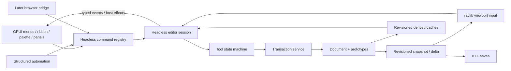

# Proposed Rust architecture

This is the architecture contract for the Rust implementation. Settled direction: desktop first, GPUI for the desktop shell, raylib-rs for its 3D viewport, commands independent of UI/rendering, Android/Groovy execution/developer CLI/TUI deferred, JavaScriptCore plugins with a handed-in context in the final product, and thorough object-model normalization before core contracts harden. The Bevy/egui stack is superseded by [ADR-06](../decisions/ADR-06-gpui-raylib.md), [T59](handoffs/T59.md) and [T60](handoffs/T60.md). The GPUI/raylib native-surface proof is a hard gate; CPU framebuffer readback is not an acceptable production viewport path. Preserve the normalized model, headless commands and IO while replacing the renderer and UI. The object-model decision is gated by T46.

## Workspace boundaries

Start with a small Cargo workspace; use modules within crates before introducing more packages.

| Crate | Owns | Must not depend on |
| --- | --- | --- |
| `meshcraft-core` | f64 geometry, document/prototypes, selection, transactions, command metadata/handlers, tool state machines, domain generators, snapshot extraction | GPU/UI types, OS dialogs/filesystem, HTTP server, JVM, browser globals |
| `meshcraft-io` | Sparse legacy DTOs, project/history containers, migration/validation, supported interchange codecs | Widget lifetime, live render thread, implicit mutation of document |
| `meshcraft-session` | Headless command dispatch, tool/session state, typed viewport input/output, undo and host-effect requests | GPUI, raylib, windowing, GPU types |
| `meshcraft-render` | raylib-rs viewport, GPU batches, renderer-neutral snapshots/deltas, camera presentation and picking; CPU offline renderer remains separate | GPUI callbacks, authoritative model edits |
| `meshcraft-ui` | GPUI shell, command-backed menus/ribbon/palette, inspectors/forms, focus/input routing and workspace layout | Independent modeling implementations, direct document mutation |
| `meshcraft-desktop` | GPUI application lifecycle, viewport host surface, OS dialogs/files, serialized saves, structured HTTP automation, packaging and host services | Feature-specific geometry algorithms |
| `meshcraft-web` (later) | WASM entry, JS wrapper bridge, browser files/storage, cooperative scheduling | Native filesystem/server/thread assumptions |
| `meshcraft-plugins-jsc` (later) | JavaScriptCore FFI/lifetimes, runtime executor, plugin lifecycle and versioned context adapter | Direct mutable document/store access, GUI widget ownership, assumptions that native JSC runs in browser WASM |

Suggested core module ownership: `geometry/`, `document/`, `selection/`, `commands/`, `transactions/`, `tools/`, `domains/{voxel,architecture,hvac,hotspot}/`, `jobs/`. Session modules: `dispatch/`, `input/`, `tool_state/`, `effects/`. IO modules: `legacy/`, `project/`, `mesh/{obj,stl,dxf,...}/`, `ifc/`. Renderer: `viewport/`, `snapshot/`, `offline/`. UI: `menus/`, `ribbon/`, `palette/`, `panels/`, `input/`, `workspace/`.

Host composition lives in a short application coordinator. Avoid recreating the existing 12,809-line Main, 9,166-line GroupScene and 7,468-line SketchUiOverlay as three Rust structs with all responsibilities. The sum of their responsibilities remains necessary; their coupling does not.

## UI and renderer stack proof

Use GPUI for the desktop shell and raylib-rs for the custom 3D viewport, as specified in [ADR-06](../decisions/ADR-06-gpui-raylib.md) and [UI-3D_renderer.md](../UI-3D_renderer.md). The application follows the SolidCraft organization (text menu, grouped ribbon, central viewport, right inspector) and CADCraft command completion (`Ctrl+Shift+P`). Existing command IDs and JSON parameter definitions drive all presentations. Keep the core command/session service headless; GPUI routes actions into it, while raylib consumes revisioned scene snapshots and returns typed interaction events.

T59 must prove a native raylib surface can occupy the actual GPUI viewport rectangle without continuous CPU framebuffer readback. Verify the target Linux window backend, composition/clipping, DPI/resize, focus, event routing and shutdown. Pin GPUI/component/raylib revisions only after this works. T60 then removes Bevy, bevy_egui, egui/eframe and retired renderer modules after their behavior has been replaced. Do not claim Windows/macOS support until their native-surface paths pass the same gate. See the [GPUI upstream README](https://github.com/zed-industries/zed/blob/main/crates/gpui/README.md) and its [external-compositor discussion](https://github.com/zed-industries/zed/discussions/60572) for current API constraints.

GPUI Component is the preferred rich-widget source after a dependency/license fit check. Reuse focused widgets when practical; connect them to Meshcraft's command/session and JSON settings boundaries. SolidCraft and CADCraft remain visual/interaction references; their egui implementation is not carried into the new stack.

Keyboard-accessible menus, text/IME input, focus, shortcut suppression/restoration, enabled/checked state and viewport event ownership are release requirements. UI pointer events reach the model only when they fall inside the laid-out viewport and are not consumed by a control.

## State contracts: T46 decision before T02–T06 implementation

Read [object-model.md](object-model.md) for the source/fixture-backed ownership audit. The current layout is a compatibility input, not the canonical Rust schema. T46 settles identity, shared content/layouts, authored edits versus caches and migration examples before dependent contracts become fixed.

| Contract | Rules |
| --- | --- |
| `Document` | Stable definitions/content/layouts/placements, model settings, revision, opaque compatibility/extension data; serializable without caches or expanded no-op instance copies |
| `Definition` / `GeometryBundle` | One owner for authored metadata, local geometry and domain/hotspot inputs; indexed vertex storage evaluated by T46 |
| `ChildLayout` / `OccurrenceRef` | Shared child templates with explicit occurrence addressing and genuine authored layout differences; no independently mutable cloned child tree per reuse |
| `InstanceEdits` | Typed authored overrides/inputs; inheritance differs from explicit empty replacement; generated snapshots are not authored by default |
| `EditorSession` | Active edit context, selection, current tool/draft, view/camera modes, transient guides, UI focus, user-facing status |
| `ApplicationPreferences` | Workspace profile/layout, visual grid presentation, UI scale, navigation tuning; distinct from ModelSnapshot |
| `GeometryStore` | Stable vertex/segment/triangle identity policy, per-face colors and raw insert path; edit path explicitly requests splitting/cleanup |
| `ResolvedInstance` | Shared effective-content view from definition/occurrence inputs and transforms; only changed/generated content is materialized, keyed by relevant revisions |
| `Transaction` | Captures before state/delta, owns commit/cancel, emits one change set and undo entry; no partial publication on failure |
| `CommandDescriptor` | Stable ID, label/menu location, payload schema, capability, enable/check query, shortcut, handler |
| `CommandResult` | Completion/failure, scene revision, diagnostics, selected result, optional job ID; dispatch is distinct from completion |
| `ToolEvent` | Screen/world hit, valid flag, normal, pointer/button/modifiers, event phase, viewport rectangle, context identity |
| `ToolState` | Typed stages with source snapshot, transient preview and numeric meaning; emits transaction/host effects |
| `ChangeSet` | Changed IDs/stores/prototypes, geometry/appearance/selection/settings kinds, invalidated bounds/derived data |
| `HostServices` | File dialogs/read/write, preferences, clock/jobs/cancellation, external-link resolver, UI/capture effects |
| `JobResult` | Input document/revision and cancellation token; apply only under documented current-revision policy |
| `RenderSnapshot` | Resolved geometry/material colors, transforms, camera/lights and revision; no references into mutable UI |

Core commands with host effects return an effect/request to the platform coordinator rather than opening OS dialogs synchronously. Model-changing command handlers run on one application owner; worker jobs consume immutable inputs and return results. Render callbacks never edit model geometry. Native synchronous tests use a deterministic job runner/clock, not sleeps.

Define direct typed modeling operations independently of pointer-driven tools. Tools, import converters and typed automation can call the same operation service without synthesizing GUI clicks for every internal edit. End-to-end tool tests still exercise the pointer/keyboard state machine to catch interaction defects.

## Geometry and topology choice

Retain segment-plus-triangle primitive semantics and legacy codec compatibility; canonical container layout is decided by T46. The recommended normalization is a per-bundle stable vertex table with indexed primitives and per-face RGBA, eliminating repeated coordinates where identity is established. Derive adjacency, boundary loops, coplanar regions, normals and indexes. Preserve coincident independent vertices and legacy primitive-slot aliases; position equality is not identity. A half-edge/B-rep migration is not implied.

Use robust plane projection for planar operations, explicit predicates/tolerances and staged replacement. Maintain per-primitive identity remaps when splits/merges replace topology so selection and hotspot attachments can be reconciled. Do not silently merge geometrically close but intentionally separate context vertices. Editing insertion and raw loading are distinct APIs, checked by tests and benchmarks.

Precision proposal: f64 modeling coordinates, f32 GPU positions relative to a chosen frame/origin if large-coordinate rendering requires it. Legacy epsilon/quantization policies are named compatibility inputs. Reject NaN/infinite coordinates and singular transforms with useful diagnostics. Nonmanifold/open meshes remain valid editable documents; only operations that require a closed solid reject them.

## Shared UI model

Define one action tree that maps commands into menu locations, ribbon groups, palette tags, shortcuts and tutorial action IDs. `Ctrl+Shift+P` exposes every available command. Tool registration supplies its label, category, command, parameter hints and enabled/checked state. Window menu/panel registry and ribbon visibility are similarly generated. File/render/selection callbacks become canonical commands before the GPUI shell is built.

Desktop Menus, Buttons and Hybrid are presentations of the same session. Profile switching changes layout and visibility only. Use the GPUI viewport's measured content rectangle; convert logical coordinates and scale exactly once at the GPUI/raylib boundary. Camera projection, picking, overlays, automation screen input and captures share that mapping. GPUI handles focus first; normalized input reaches the model only when unconsumed. Keep model commands separate from text-widget edit commands to avoid shortcut collisions.

MacOS native menu integration, if selected, adapts the same action tree and state queries. A native menu cannot own a second undo stack or duplicate file-operation logic. Window/panel state and menu checkmarks read actual state after loads/undo/async completion.

## Undo/save strategy

Start with explicit transactions and bounded snapshot-backed undo for correctness; avoid premature complex per-primitive inverse commands. Immutable shared storage or affected-store snapshots reduce copying once measured. Each completed tool operation is an intentional history boundary. Continuous previews and intermediate invalid field text are not edits. Native history includes authored document settings and geometry but excludes editor selection, camera, lighting/shadow controls, and application preferences. It uses one history entry per commit rather than legacy 3.5-second debounce coalescing; the current limits are 20 operations and 64 MiB of serialized snapshot data.

Keep old base64/gzip history entries intact and lazily decode on access. Native transaction entries can use a separate internal representation until a new file format decision is made. Atomic save uses a complete immutable revision and serialized job queue; no raw pointers to the mutable document cross worker boundaries. Load builds a candidate document and publishes only at validation completion.

## Domain generation

Voxel, architecture and HVAC parameters own semantic intent; generated meshes/lines are caches with source-ID attribution for selection handles and deletion. Hotspot definitions own attachments and an operation graph; instance state supplies overrides and evaluation inputs. A generator returns geometry plus source mapping/diagnostics and cannot mutate unrelated stores.

Use one regeneration/invalidation protocol for all domains, while keeping domain-specific parameters/types. Explode materializes resolved output into ordinary geometry and discards domain behavior only on explicit user action. Raw import retains unknown parameters until that feature module is available.

Domain components and the object's edit profile have different purposes. The legacy MESH root contains architecture/HVAC data, so an exclusive Mesh-or-Voxel-or-Architecture payload enum would lose valid combinations. One canonical owner retains domain parameters; source-attributed generated content lives in resolved caches, with legacy snapshots handled by codecs.

## Later JavaScriptCore plugin boundary

[plugins.md](plugins.md) defines the required native engine and proposed context/SDK. Pass a versioned, plugin-scoped facade into activation. Use targeted value queries with stable IDs/occurrence references, the shared dispatcher for commands, and validated atomic batches for edits. Do not expose the old GroupNode/store layout or a mutable Rust document proxy. Public context types must survive normalization without mirroring private storage.

JSC values/callbacks belong to a runtime executor with explicit GC/context lifetime. Application mutations remain on the application owner. Native package/linking/promise/interruption proofs are T47 work, followed by lifecycle/context integration in T48/T49 and release qualification in T50. Initial desktop and browser qualification do not depend on these later plugin tasks. Native plugin support does not restore Groovy or the CLI/TUI.

## Decision register

| ID | Status / decision | Verification owner |
| --- | --- | --- |
| ADR01 | Accepted scope: desktop first, browser later, Android deferred | Plan/release gates |
| ADR02 | Accepted scope: menus plus button interface; desktop menu profile default proposed | T08 validates behavior and default preference |
| ADR03 | Accepted scope: Groovy/JVM plugin execution and developer CLI/TUI deferred; initial desktop has no plugin runtime | T42 capability/unknown-data audit |
| ADR04 | Superseded: initial eframe/egui and Bevy UI/rendering directions | Historical; see ADR05 and ADR06 |
| ADR05 | Superseded: egui application shell with Bevy model viewport | Historical migration handoff; see ADR06 |
| ADR06 | Accepted direction: GPUI shell, raylib-rs viewport, headless session; no CPU frame readback | T59 native-surface proof, T60 removal and C39–C41 |
| ADR05 | Proposed: f64 kernel and triangle/segment semantics; canonical vertex/layout/override storage decided before implementation | T46 then T02/T03; C01/C02/C32 |
| ADR06 | Proposed: sparse schema-17 compatibility reader/writer, explicit defaults allowed | T05/T09 Kotlin reopen proof; no new incompatible format under version 17 |
| ADR07 | Proposed change: transaction boundaries instead of 3.5 s undo coalescing | T04 documents policy and legacy-history replay |
| ADR08 | Proposed change: atomic disk saves instead of reproducing direct file replacement | T09 crash/failure/cancel cases |
| ADR09 | Unresolved implementation choice: polygon clipping/triangulation stack | T01 fixture proof; freeze before T13/T22 |
| ADR10 | Proposed: retained structured HTTP/MCP subset, explicit console unsupported | T41 contract tests; no Groovy dependency |
| ADR11 | Unresolved product metadata: name, app ID, default extension/executable aliases | T44 records release metadata; keep both legacy readers |
| ADR12 | Later design: Android shell and any developer console; Groovy plugins need a source/API port, not binary compatibility | Outside first-phase dependencies |
| ADR13 | Accepted requirement: examine and remove object-model redundancies; proposed shared normal form in object-model.md | T46 gates T02/T03/T05/T16; C32 |
| ADR14 | Accepted final-product direction: WebKit JavaScriptCore for native plugins, handed an application context | Required later T47–T50; Linux/Windows/macOS proof, C33 |
| ADR15 | Proposed context API: versioned value/ID/occurrence queries and transactional edits over shared host services | Early F10 boundary; T48/T49 implementation; C18/C32/C33 |

Agents can resolve routine implementation choices inside these boundaries and record evidence. An unresolved choice does not justify stalling independent tasks. Changes to stable file semantics, command IDs, core contracts or the accepted scope require a short explicit decision record and coordinator review before dependent work is merged.
