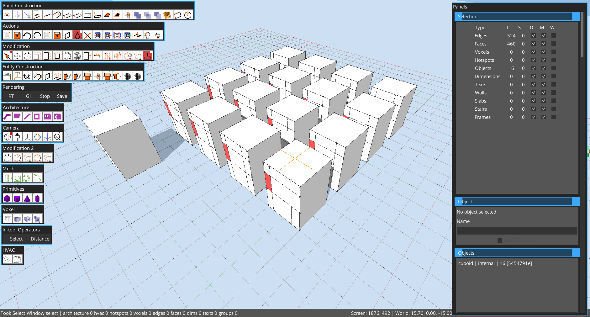
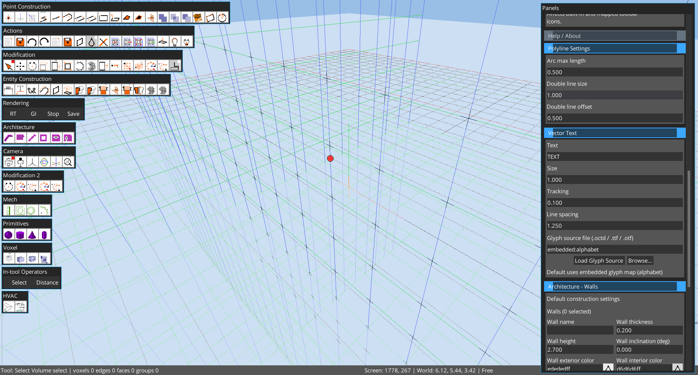
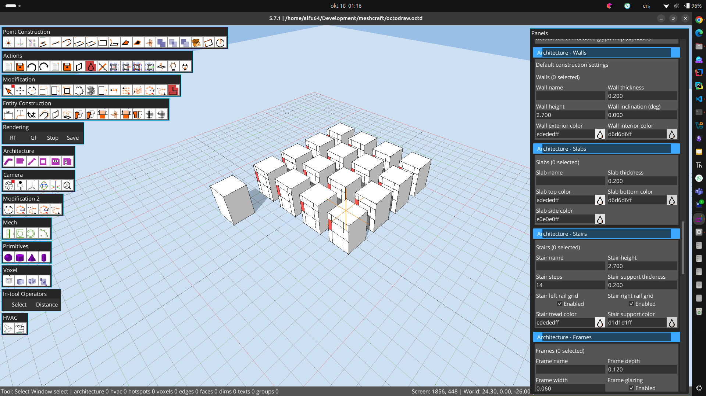

# Supplemental Legacy UI Reference

These captures document a running desktop build inspected on 2026-10-18. Its MCP contract identifies Octodraw 5.7.1, commit `5c97836026cf8274ad43d99542a3057b215231c4`; the pinned source baseline is 5.7.2 at `acd84f4c67509e10363c33850501eb8f4fc3ffa7`. Use this page for visual layout and configuration clues only. It is not a geometry or parity oracle for the pinned source. The user-supplied settings-panel captures are 1920×1080; the earlier workspace and command-palette captures are 1882×1011.

The supplied screenshots show thirteen labeled toolbar groups at the left: Point Construction, Actions, Modification, Entity Construction, Rendering, Architecture, Camera, Modification 2, Mech, Primitives, Voxel, In-tool Operators, and HVAC. The right side is a vertically scrolling accordion titled “Panels,” with a status strip along the bottom. `Ctrl+Shift+P` opens the command palette. The visible palette reports 138 commands; searching `Rectangle` shows `Tool> Rectangle` and `Tool> Surface Rect`. MCP `/scene/listCommands` also returned 138 entries: Tools 74, View 52, Edit 7, Export 4, Import 1. The MCP exposed six tools and five resources. Palette search and display were observed; command activation was not verified in this inspection.

Visible UI/configuration values include:

- UI: 1× text, 32×32 toolbar icons, auto-collapse off, permanent grid on, Y-up, extent 20, normal/thick widths 1/3 px.
- Model: unit size 1, grid size 1, 24 circle segments; walk speed 24, jump 16, gravity 48, height-adjust speed 8.
- Polyline/vector text: arc length 0.5, double-line size/offset 1/0.5; text `TEXT`, size 1, tracking 0.1, line spacing 1.25, source `embedded:alphabet`.
- Architecture/HVAC: wall thickness/height 0.2/2.7; pipe diameter/sides 0.2/16; duct size 0.5×0.25, hump half-span 0.625 and clearance 0.05.
- Hotspot/random/lighting: the default hotspot operation is MOVE with CIRCLE shape; random array count 12, zero scale/rotation fuzz, normal alignment enabled, remesh subdivisions 12 and tolerance 0.05. Shader controls expose shadow, directional, ambient and specular value/alpha settings.

The user-confirmed modeling sequence is cuboid → copy → create an object from the copied selection → array that object. The current viewport shows the resulting regular cuboid array, the Objects panel lists 16 objects, and the Selection panel reports 16 objects, 460 faces and 524 edges. The Random Surface Array settings show a copy count of 12. These are live document values, not a fixture contract.

The full panel walk-through confirmed the open sections: Selection, Object, Objects, Model Settings, UI Settings, Help / About, Polyline Settings, Vector Text, Architecture - Walls, Architecture - Slabs, Architecture - Stairs, Architecture - Frames, HVAC Settings, Hotspot Settings, Random Tools, Tutorials, and Shader Settings. The current UI uses blue section headers with all sections expanded inside one vertically scrolling panel.

MCP snapshots changed during inspection: one read showed the root group, Select/Orbit, 12 faces, 12 edges, no voxels and one selected face; a later read showed 16 groups, 444 faces, 504 edges, no voxels and no selection. This state is volatile and is not a fixture. No scene command or save was issued during those reads. The reported MCP port was 8765; no listener was present on the user-reported 5678.

An additional live read on 2026-10-18 reported 16 groups, 460 faces, 524 edges, no voxels and no selection. It supersedes the intermediate 444-face snapshot above for this walkthrough only.

Viewport lines and points in these captures include transient overlays; do not use these images to judge geometry rendering fidelity.
