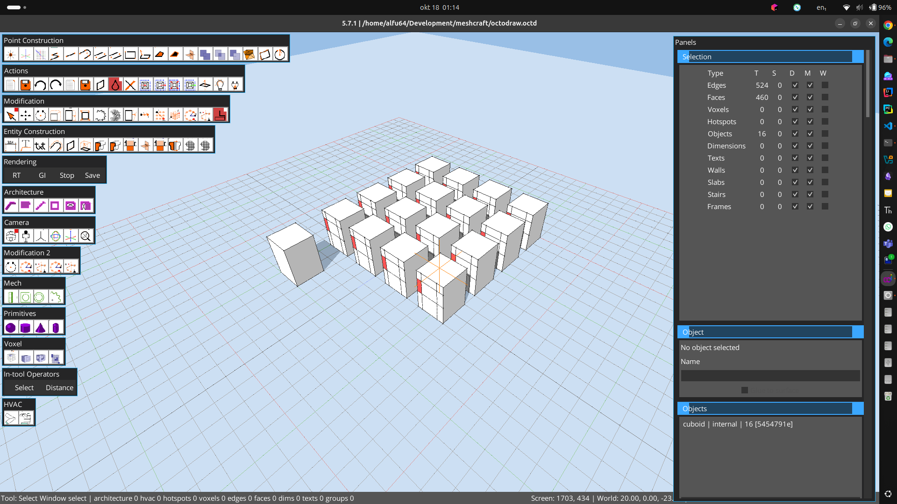
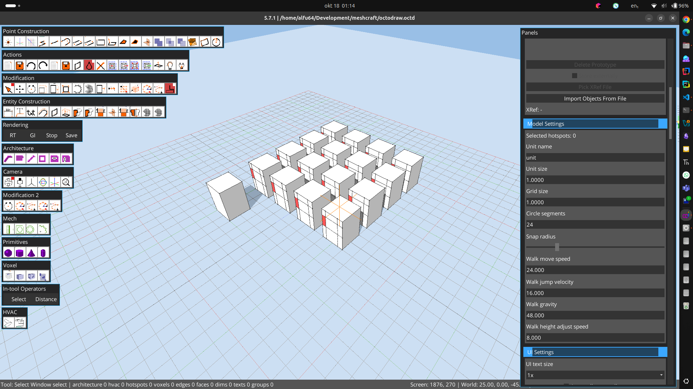
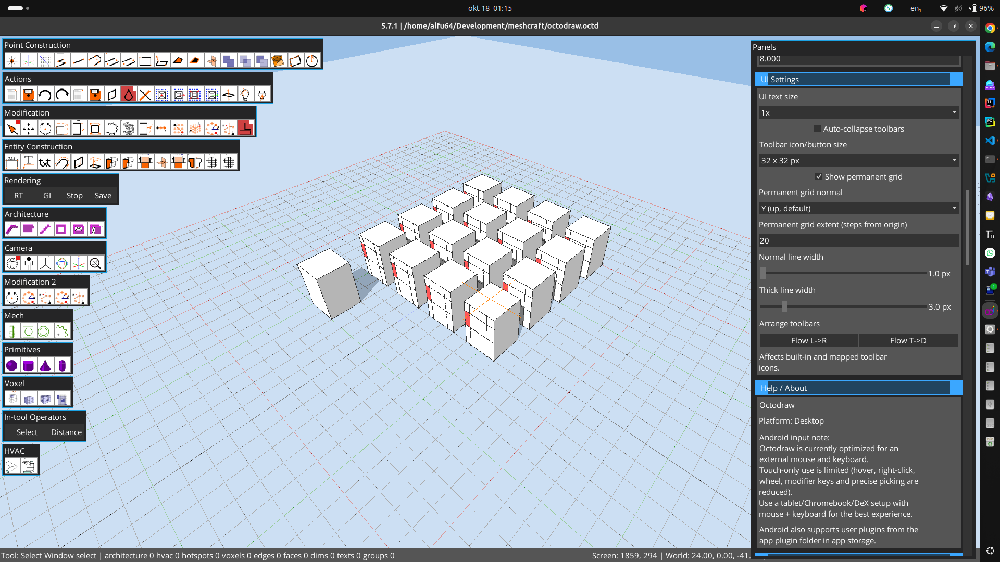
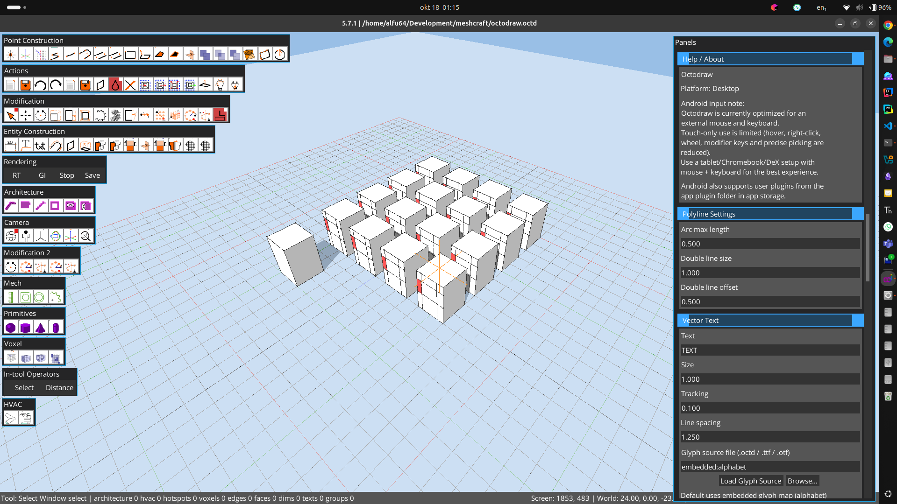
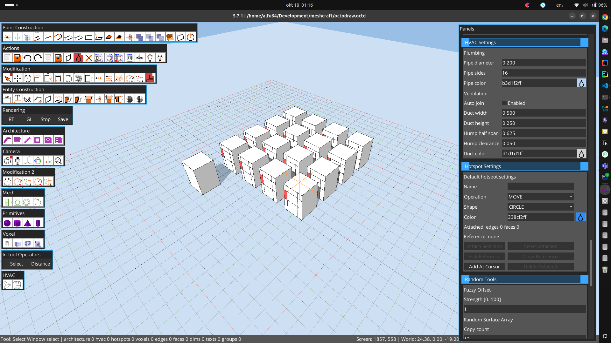
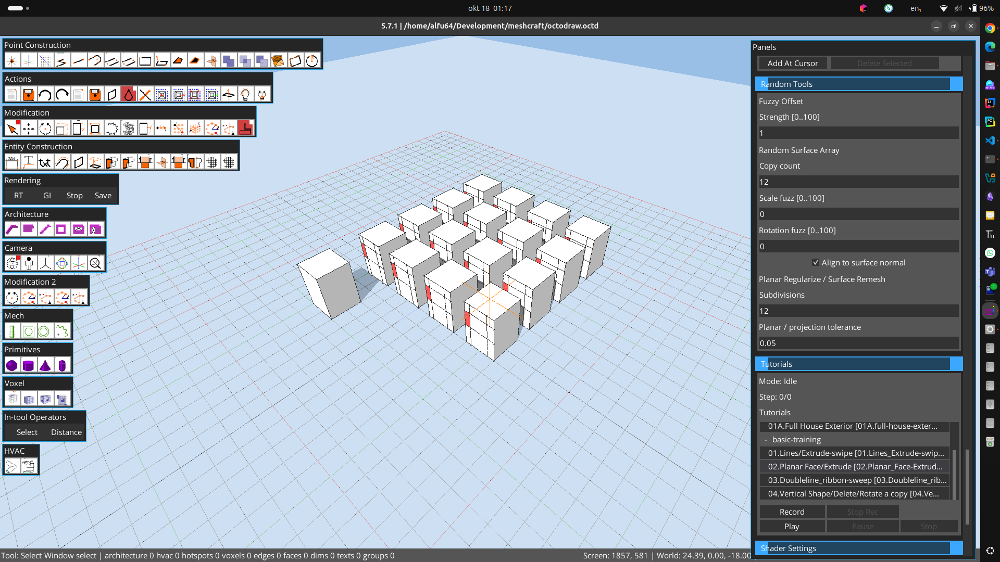
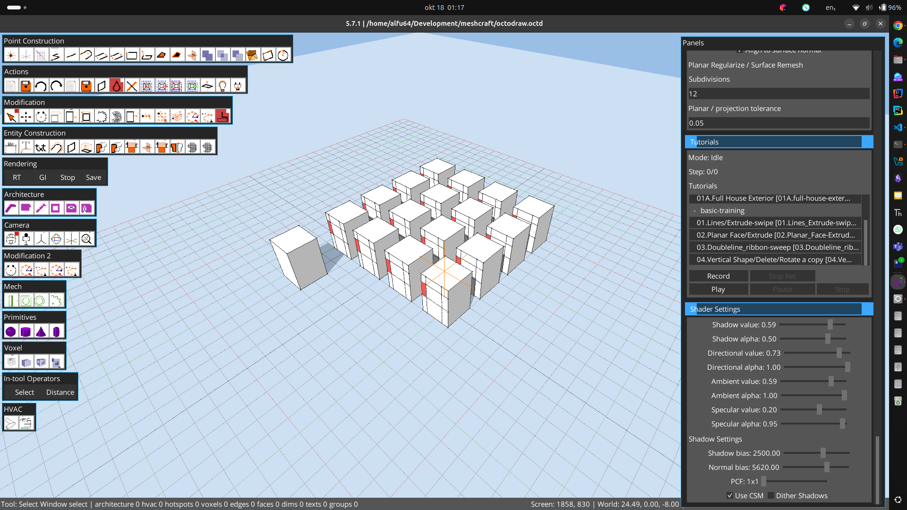
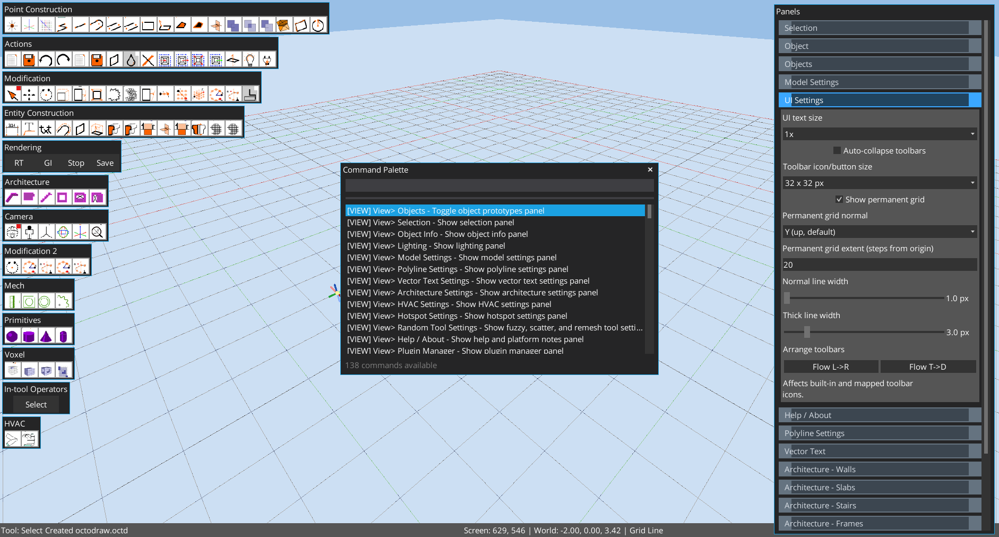

# Supplemental Legacy UI Reference

These captures document a running desktop build inspected on 2026-10-18. Its MCP contract identifies Octodraw 5.7.1, commit `5c97836026cf8274ad43d99542a3057b215231c4`; the pinned source baseline is 5.7.2 at `acd84f4c67509e10363c33850501eb8f4fc3ffa7`. Use this page for visual layout and configuration clues only. It is not a geometry or parity oracle for the pinned source. The user-supplied settings-panel captures are 1920×1080; the earlier workspace and command-palette captures are 1882×1011.

The supplied screenshots show thirteen labeled toolbar groups at the left: Point Construction, Actions, Modification, Entity Construction, Rendering, Architecture, Camera, Modification 2, Mech, Primitives, Voxel, In-tool Operators, and HVAC. The right side is a vertically scrolling accordion titled “Panels,” with a status strip along the bottom. `Ctrl+Shift+P` opens the command palette. The visible palette reports 138 commands; searching `Rectangle` shows `Tool> Rectangle` and `Tool> Surface Rect`. MCP `/scene/listCommands` also returned 138 entries: Tools 74, View 52, Edit 7, Export 4, Import 1. The MCP exposed six tools and five resources. Palette search and display were observed; command activation was not verified in this inspection.

The following are values visible in the supplied captures; they are sample state, not assertions about factory defaults:

- Selection/Object/Objects (image 1): 524 edges, 460 faces, 16 objects and one visible `cuboid | internal | 16` entry; no selected object is reported in the Object editor.
- Model Settings (image 2): unit `unit`, unit size 1, grid size 1, 24 circle segments; snap radius is a slider. Walk speed is 24, jump velocity 16, gravity 48 and height-adjust speed 8. XRef is `-`.
- UI Settings (image 3): text scale 1×, auto-collapse off, toolbar size 32×32, permanent grid on, Y-up, extent 20, normal/thick widths 1/3 px. Help / About identifies Octodraw on Desktop.
- Polyline and Vector Text (image 4): arc max length 0.5, double-line size/offset 1/0.5; text `TEXT`, size 1, tracking 0.1, line spacing 1.25, glyph source `embedded:alphabet`.
- Architecture (image 5): wall thickness/height/inclination 0.2/2.7/0; slab thickness 0.2; stair height 2.7, 14 steps, support thickness 0.2 and both rail grids enabled; visible frame depth/width 0.12/0.06 with glazing enabled.
- HVAC and Hotspot Settings (image 6): pipe diameter/sides 0.2/16; duct width/height 0.5/0.25, hump half-span 0.625 and clearance 0.05. The visible hotspot template uses MOVE, CIRCLE and color `338cf2ff`.
- Random Tools and Tutorials (image 7): fuzzy offset strength 1; random array count 12, scale/rotation fuzz 0 and surface-normal alignment on; remesh subdivisions 12 and tolerance 0.05. Tutorials show Idle, step 0/0 and playback controls.
- Shader Settings (image 8): shadow value/alpha 0.59/0.50, directional 0.73/1.00, ambient 0.59/1.00, specular 0.20/0.95; shadow bias 2500, normal bias 5620, PCF 1×1, CSM on, dithering off.

The user-confirmed modeling sequence is cuboid → copy → create an object from the copied selection → array that object. The current viewport shows the resulting regular cuboid array, the Objects panel lists 16 objects, and the Selection panel reports 16 objects, 460 faces and 524 edges. The Random Surface Array settings show a copy count of 12. These are live document values, not a fixture contract.

The full panel walk-through confirmed the open sections: Selection, Object, Objects, Model Settings, UI Settings, Help / About, Polyline Settings, Vector Text, Architecture - Walls, Architecture - Slabs, Architecture - Stairs, Architecture - Frames, HVAC Settings, Hotspot Settings, Random Tools, Tutorials, and Shader Settings. The current UI uses blue section headers with all sections expanded inside one vertically scrolling panel.

MCP snapshots changed during inspection: one read showed the root group, Select/Orbit, 12 faces, 12 edges, no voxels and one selected face; a later read showed 16 groups, 444 faces, 504 edges, no voxels and no selection. This state is volatile and is not a fixture. No scene command or save was issued during those reads. The reported MCP port was 8765; no listener was present on the user-reported 5678.

An additional live read on 2026-10-18 reported 16 groups, 460 faces, 524 edges, no voxels and no selection. It supersedes the intermediate 444-face snapshot above for this walkthrough only.

## Right-hand Panels screenshots

These eight 1920×1080 captures were compared byte-for-byte with the screenshots supplied for this walkthrough. The numbered list follows attachment order. Filenames and captions name every visible section, including partial sections at crop edges; a heading at a crop edge does not mean its full section is shown. “Panels” means the vertically scrolling inspector/settings column on the right, distinct from the centered command palette.

1. Selection totals, the empty Object editor, and the `cuboid | internal | 16` Objects entry: 
2. XRef actions, Model Settings through walk-height-adjust speed, and the first UI Settings field: 
3. The final walk-height-adjust value, UI Settings controls, and Help / About: 
4. Help / About tail, Polyline Settings, and Vector Text through the embedded glyph source: 
5. Architecture - Walls, Slabs, Stairs, and the visible top of Frames; the Frames section continues below the crop: 
6. HVAC Settings, Hotspot Settings, and the beginning of Random Tools: 
7. Random Tools (Fuzzy Offset, Random Surface Array, and Planar Regularize / Surface Remesh), Tutorials and playback controls, plus the Shader Settings heading: 
8. The tail of Random Tools, Tutorials, and visible Shader Settings controls through shadow bias, normal bias, PCF, CSM, and dithering: 

## Command palette screenshot

This separate 1882×1011 image shows the centered command picker and its 138-command count over the workspace. The right-hand Panels column is also visible: UI Settings is expanded and the other visible section headers are collapsed. Treat it as combined command-picker/sidebar state, not as a dedicated settings walkthrough: 

Viewport lines and points in these captures include transient overlays; do not use these images to judge geometry rendering fidelity.
