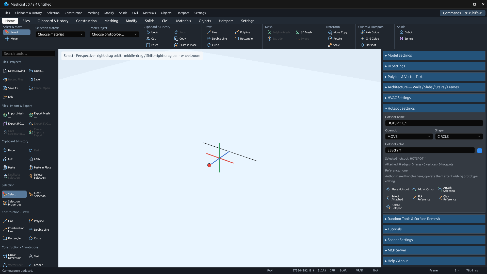
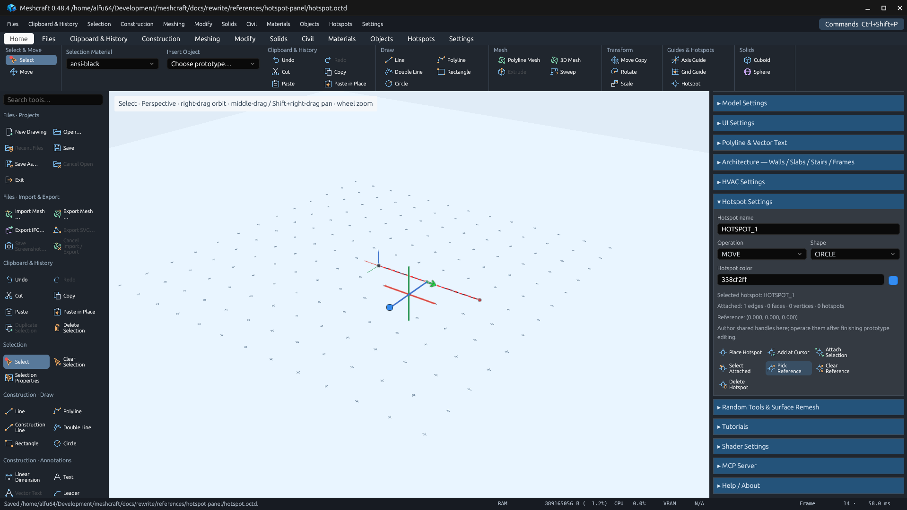

# Hotspot inspector actions — 0.48.4

Hotspot Settings includes Place Hotspot, Add at Cursor, Attach Selection,
Select Attached, Pick Reference, Clear Reference and Delete Hotspot immediately
below its properties and attachment/reference summary. These are the existing
registered commands, retaining their selection and prototype/root authoring rules.
Instance hotspot operations still require prototype editing to be closed.

The [native recipe](../../../../scripts/verify_hotspot_panel.py) runs in an isolated
Linux Xvfb/Mesa desktop and retains its fixture, captures and actions in this folder.
No user drawing is modified.

## Validation

Passed on Linux on 2026-10-31:

- `cargo fmt --all --check`
- `cargo test --workspace --locked`: 797 passed, 22 existing ignored tests.
- `cargo clippy --workspace --all-targets --locked -- -D warnings`
- `cargo build -p meshcraft-desktop --locked`
- `python3 scripts/verify_hotspot_panel.py`: all seven panel buttons exercised
  through native clicks. Attached one line, selected the attached line, picked
  `(0,0,0)` as reference, cleared it, deleted the hotspot, placed a new hotspot,
  added another at cursor `(5,0,2)` and deleted it. Source line records stay
  unchanged. The saved fixture retains the configured attachment/reference.
- `python3 scripts/export_tool_inventory.py` and `--check`: 290 commands;
  review columns preserved.
- `python3 docs/rewrite/scripts/verify_plan.py`
- `python3 -m py_compile scripts/verify_hotspot_panel.py` and `git diff --check`.

The first parallel test run had one existing JavaScript engine test fail with
`JavaScript execution terminated.` while other builds were active. A serialized
run (`RUST_TEST_THREADS=1 cargo test --workspace --locked`) and a subsequent default
run both passed all 797 tests. No execution limits or assertions were changed.
Cargo's existing future-incompatibility notice for dependency
`proc-macro-error2 2.0.1` remains unchanged; Clippy exits successfully.

Evidence: [saved fixture](hotspot.octd), [native assertions and clicks](native-validation.json),
[MCP actions](mcp-actions.json) and [capture receipts](capture-receipts.json).

