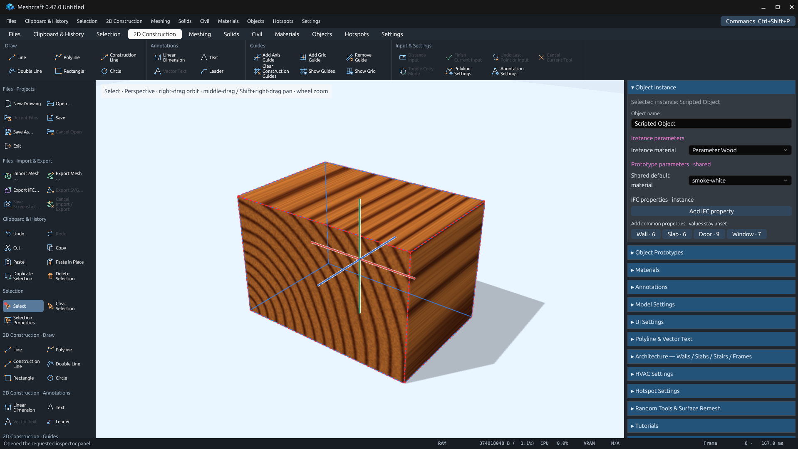
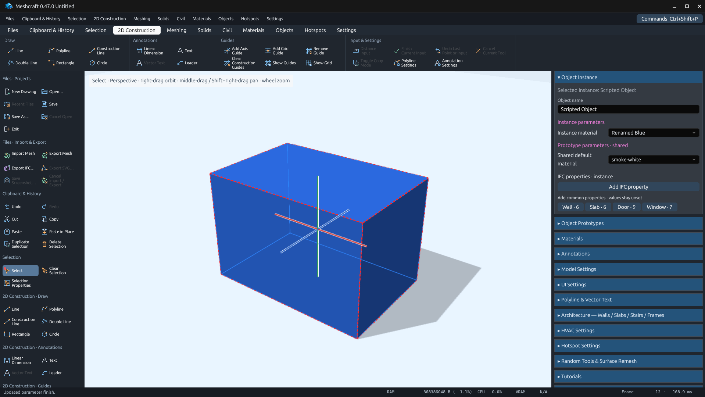

# Material parameters — 0.47.0

Object scripts can declare `$MATERIAL(id, label=id, defaultValue='ansi-grey')` at
prototype scope or in `onCreate` for independent instance choices. Values store
catalog IDs; `onAnimationFrame(params)` receives immutable resolved materials.
See [API documentation](../../../script-parameters.md#material-parameters).

## Observed native behavior

The actual GPUI application ran in a private Linux Xvfb desktop with Mesa software
rendering. MCP created the fixture, assigned materials, queried generated faces,
and saved/reopened the project. Screenshots are unaltered app-window captures.

- Prototype and instance material inputs appear in Object Instance properties.
- Procedural Wood applies to generated faces through their catalog material ID.
- Adding and renaming a catalog material updates the existing picker.
- A mixed two-instance selection accepts a material edit for both instances.
- Deleting a referenced material is rejected; save/reopen retains choices.





Reproduce with a built desktop executable:

```sh
python3 scripts/verify_material_parameters.py --binary target/debug/meshcraft
```

The recipe uses [material-component.js](material-component.js).
[Native assertions](native-validation.json), [capture receipts](capture-receipts.json),
[MCP actions](mcp-actions.json), and [saved fixture](material-parameters.octd)
are retained alongside the images. The recipe changes only an isolated application
and its own fixture; it does not operate on the user's desktop.

A separate private run opened a copy of the user's kitchen drawing and checked all
18 cupboard/door/drawer instances for their native material fields and script errors.
All passed. The user drawing and its contents are not published in this evidence.
Compatibility scripts select `$MATERIAL` on this build and retain their `$LIST`
fallback for older running builds.

## Automated verification

- `cargo fmt --all --check`
- `cargo test --workspace --locked`: 781 passed, 22 ignored, no failures.
- `cargo clippy --workspace --all-targets --locked -- -D warnings`
- `python3 docs/rewrite/scripts/verify_plan.py`
- Tool inventory, icon catalog and inventory preservation checks.

Core tests cover reference validation, copying, serialization, deletion protection
for unplaced defaults, and generated shader material bindings. JavaScriptCore tests
cover prototype/instance resolution, renamed catalog entries without reinitializing,
immutable catalog values, missing-ID fallback, rejection of frame declarations, and
material-only evaluation without parsing the scene geometry query facade.

No new commands were registered (290 commands), so the stress-suite tool coverage
is unchanged. These checks verify this feature; they are not performance results.

## Scope

A script remains responsible for its emitted finishes. Ordinary paint operations on
authored geometry do not override hard-coded generated materials. Scripts should
expose material slots for parts such as a drawer box and face or a frame and glazing.
The selector uses current material names; previews/swatches inside its dropdown
are not part of this change.
