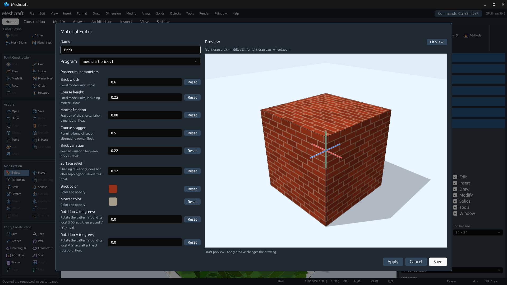
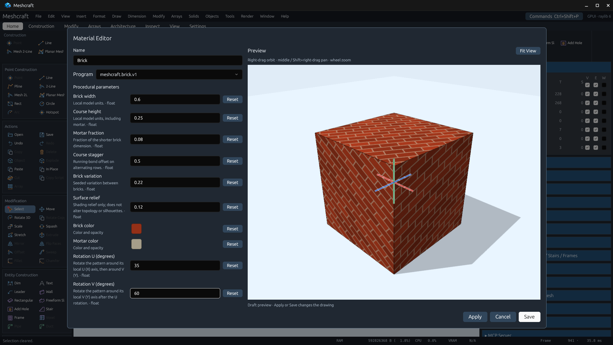

# Material settings previews

The real Material Editor previews all materials using the same isolated
GPU scene and camera controls as procedural object settings. The settings scroll
independently. Draft edits are debounced; Apply/Save commit, Cancel discards edits
not already applied. The active drawing is not cloned or edited for preview.

| Brick defaults | Rotation U 35°, V 60° |
| --- | --- |
|  |  |

These are genuine 1920×1080 Linux app-window captures, obtained while operating
the saved [material demonstration](../../../../packaging/microsoft-store/captures/06-procedural-materials.octd)
through MCP. Text input in the actual GPUI form set the rotations. Draft preview
left the drawing revision unchanged. After Save, MCP read the exact values;
Undo removed the new material, Redo restored it, and a fresh document generation
reopened its saved project with identical material settings. The reopened
material and generation evidence are retained in [roundtrip.json](roundtrip.json).

Brick and Wood expose `rotationU`/`rotationV` in degrees, about local X then Y.
Zero defaults reproduce previous materials. Shader sampling applies inverse
rotation; source geometry and object transforms remain unchanged. Both values
also support existing material assignment overrides and MCP schemas.

Validation:

```sh
cargo test -p meshcraft-desktop material_form_preview_uses_the_draft_without_editing_the_drawing --locked
xvfb-run -a env LIBGL_ALWAYS_SOFTWARE=1 cargo test -p meshcraft-desktop --lib --locked procedural_brick_wood_rotations_change_the_pattern_without_changing_geometry -- --ignored --test-threads=1
xvfb-run -a env LIBGL_ALWAYS_SOFTWARE=1 cargo test -p meshcraft-desktop --lib --locked procedural_object_form_gpu_preview_animates_and_pauses -- --ignored --test-threads=1
```

All passed. The CPU test checks private Brick/Wood/Water/Grass/Foliage previews.
The GPU rotation test checks unchanged geometry, exact zero-default rendering
and changed pixels for U, V and combined rotations of both patterns, without
compiler diagnostics. The object preview still animates and settles when wind
is zero. Logs: [orientation](gpu-orientation.log), [object preview](gpu-preview.log).

## Conventional material previews — 0.45.3

[Opaque conventional material](conventional.png) and
[color/opacity draft](conventional-alpha.png) were captured in the live 0.45.3
app. The earlier Brick images and rotation round-trip evidence above remain
from 0.45.2. Every material opens with the split settings/preview layout;
Conventional uses a private cube with the actual material bound to all faces.
Preview uses the same material color/opacity renderer as the drawing. Existing
texture/shading metadata is retained without promising additional viewport
rendering features.

Native UI/MCP checks switched Conventional → Grass → Conventional, checked GPU
diagnostics and generated candidate counts, edited color/alpha, and closed the
draft. Drawing revision and history stayed unchanged. See
[validation](conventional-validation.json), [capture receipts](capture-receipts.json)
and [MCP actions](mcp-actions.json). The new CPU test
`conventional_material_preview_retains_color_alpha_and_material_fields` covers
opaque/transparent settings, texture sizes, shading metadata, actual bindings
to all 12 cube triangles, and isolation from unrelated source geometry.

Release gates: 775 workspace tests passed (22 platform/GPU checks ignored by
default); the native selected-line GPU check also passed. Formatting and strict
workspace Clippy passed.
