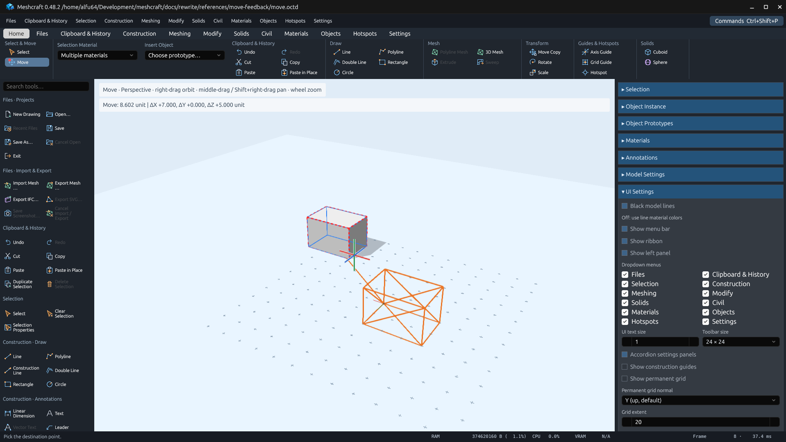

# Ribbon headings and Move feedback — 0.48.2

Ribbon groups reserve enough width for their heading and disable heading wrapping.
Home's **Guides & Hotspots** caption therefore occupies a single row.

After the Move or Move Copy reference point is picked, its phantom includes a
line from that fixed origin to the current snapped/numerically adjusted point.
This adds one feedback edge to the cached wireframe; it does not modify the
drawing during pointer movement. Rotational feedback remains center-relative.

The desktop regression `move_feedback_keeps_reference_line_with_phantom_in_move_and_copy_modes`
checks both modes, the reference edge, retained phantom and unchanged document.
Native captures use [the repeatable recipe](../../../../scripts/verify_move_feedback.py)
in an isolated Linux Xvfb/Mesa desktop, without modifying any user drawing.

## Validation

Passed on Linux on 2026-10-30:

- `cargo fmt --all --check`
- `cargo test --workspace --locked`: 797 passed, 22 existing ignored tests.
- `cargo clippy --workspace --all-targets --locked -- -D warnings`
- `cargo build -p meshcraft-desktop --locked`
- `python3 scripts/verify_move_feedback.py`: both native previews captured;
  geometry records, vertices and placement unchanged. Visual inspection confirms
  the heading occupies one row and the origin-to-pointer feedback line is visible.
- `python3 scripts/export_tool_inventory.py` and `--check`: 290 entries,
  user review columns preserved.
- `python3 docs/rewrite/scripts/verify_plan.py`
- `python3 -m py_compile scripts/verify_move_feedback.py`
- `git diff --check`

Cargo's existing future-incompatibility notice for dependency `proc-macro-error2
2.0.1` remains unchanged; Clippy exits successfully.

Evidence includes the [fixture](move.octd), [MCP actions](mcp-actions.json) and
[capture receipts](capture-receipts.json).

