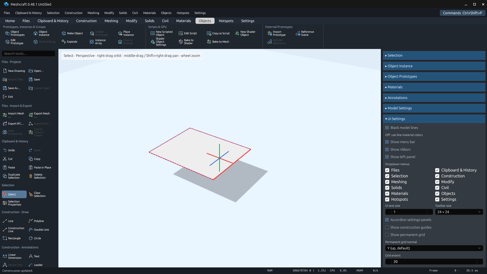
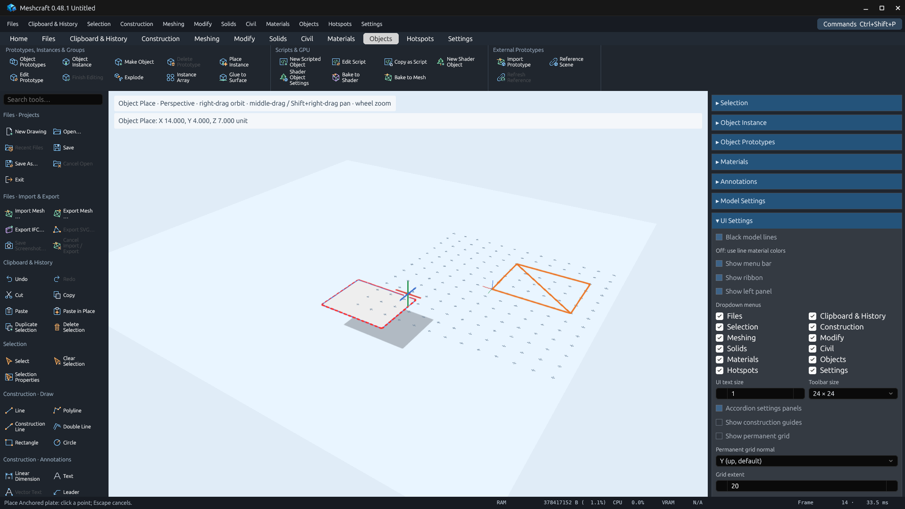

# Make Object bounding-box anchor — 0.48.1

Make Object uses `(min X, min Y, max Z)` in the active parent's axes, matching
Paste's Y-up, +Z-front convention. Mesh selections previously retained their
parent coordinates with an identity placement. Instance groups previously used
the mean of insertion points. Both now rebase their contents and put the new
instance at the geometry corner, preserving its world position.

The implementation visits only selected subtrees and reads current script or
local deformation geometry without initializing scene-wide finish/deformation
caches. It includes actual reference-offset positions and nested definition/
placement transforms. New vertices and positional domain records shift together;
child instance transforms/overrides shift relative to the new anchor.

## Checks

Core regressions cover:

- Referenced positions whose offsets place visible endpoints far from base vertices.
- Definition frames, rotation/scale and instance transform overrides.
- Nested creation inside a rotated/scaled prototype with world geometry unchanged.
- Architectural geometry and parameters staying aligned after regeneration and reopen.
- Rebasing dimension/text records while preserving unrelated opaque source records.

Native verification uses the actual GPUI app in an isolated Linux Xvfb/Mesa desktop:

```sh
python3 scripts/verify_object_anchor.py --binary target/debug/meshcraft
```

The [recipe](../../../../scripts/verify_object_anchor.py) constructs a plate at
`(4,2,8)`–`(9,2,12)`, checks an anchor of `(4,2,12)` and local corner `(0,0,0)`,
checks unchanged world geometry and Undo/Redo, places another plate at `(14,4,7)`,
and groups/places/reopens nested instances. Completed native evidence and gate
results are retained alongside this handoff. No user drawing is modified.

## Recorded results

All checks passed on Linux on 2026-10-30:

- `cargo fmt --all --check`
- `cargo test --workspace --locked`: 796 passed, 22 existing ignored tests, no failures.
- `cargo clippy --workspace --all-targets --locked -- -D warnings`
- `cargo build -p meshcraft-desktop --locked`
- `python3 scripts/verify_object_anchor.py`: native creation, Undo/Redo, placement,
  grouping and save/reopen checks passed.
- `python3 scripts/export_tool_inventory.py` and the same command with `--check`:
  290 entries; review columns preserved.
- `python3 docs/rewrite/scripts/verify_plan.py`: valid.
- `python3 -m py_compile scripts/verify_object_anchor.py` and `git diff --check`.

The [native assertions](native-validation.json), [MCP actions](mcp-actions.json),
[capture receipts](capture-receipts.json) and [saved fixture](anchor.octd) retain
the evidence. The existing Cargo future-incompatibility notice for dependency
`proc-macro-error2 2.0.1` is unchanged; Clippy exits successfully.




