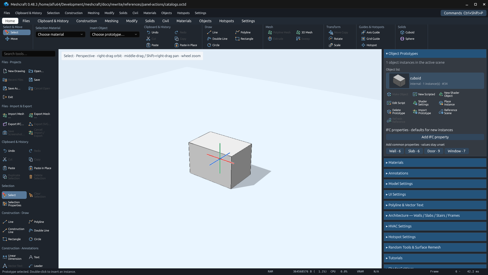
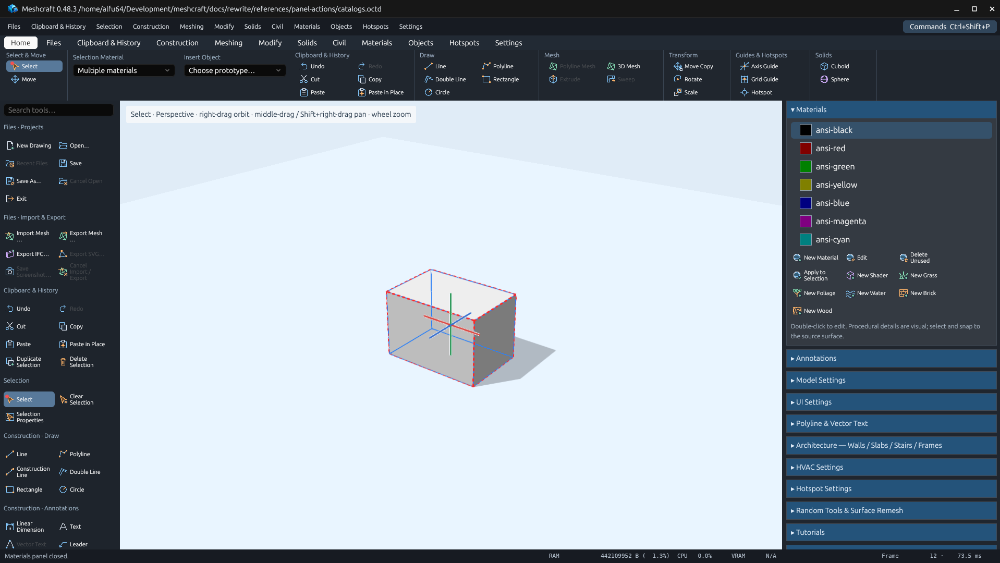
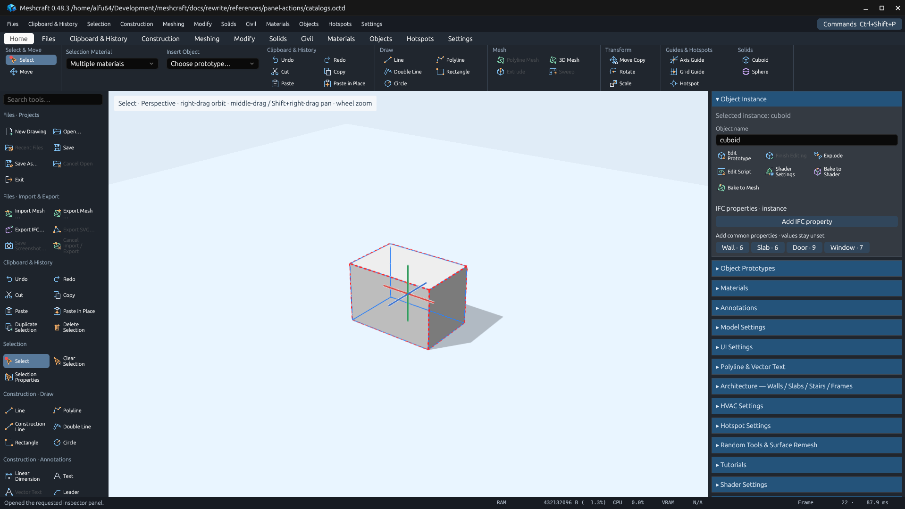

# Contextual inspector actions — 0.48.3

List management belongs beside the list it acts on. General modeling commands
remain in toolbars, with contextual shortcuts in inspectors:

- Materials: New Material, Edit, Delete Unused, Apply to Selection, New Shader,
  and the Grass/Foliage/Water/Brick/Wood creators immediately below the list.
- Object Prototypes: Make Object, New Scripted/Shader Object, Edit Script, Shader Settings,
  Place Instance, Delete Prototype, Import/Reference Scene and Refresh Reference
  immediately below the list, before IFC properties.
- Object Instance: Edit Prototype, Finish Editing, Explode, Edit Script,
  Shader Settings and Bake to Shader/Mesh next to the selected instance's name,
  before script/IFC properties.

These are bindings to the existing registered commands. Prototype deletion
retains its in-use confirmation; material deletion retains its unused-material
check. Script/shader editing resolves the selected prototype or instance through
the existing active-object mechanism. No command IDs or canonical menu placements
change.

The material list and its Edit/Apply/Delete actions share one selection resolver.
An unset or stale selection falls back to the first displayed material, avoiding
actions on an unrelated default material.

Native verification uses [the recipe](../../../../scripts/verify_panel_actions.py)
in a private Linux Xvfb/Mesa desktop. Its fixture and captures stay in this folder;
no user drawing is modified.

## Validation

Passed on Linux on 2026-10-31:

- `cargo fmt --all --check`
- `cargo test --workspace --locked`: 797 passed, 22 existing ignored tests.
- `cargo clippy --workspace --all-targets --locked -- -D warnings`
- `cargo build -p meshcraft-desktop --locked`
- `python3 scripts/verify_panel_actions.py`: native list selection, prototype
  deletion warning/cancellation, New Scripted editor, instance placement/cancel,
  material Edit/New editors and applying ANSI black to the selected instance,
  followed by Undo. The Edit preview visibly names the initially highlighted
  `ansi-black` material, confirming the shared fallback selection.
- `python3 scripts/export_tool_inventory.py` and `--check`: 290 commands,
  review columns preserved.
- `python3 docs/rewrite/scripts/verify_plan.py`
- `python3 -m py_compile scripts/verify_panel_actions.py` and `git diff --check`.

The existing Cargo future-incompatibility notice for dependency
`proc-macro-error2 2.0.1` is unchanged; Clippy exits successfully.

Retained evidence: [fixture](catalogs.octd), [native assertions and clicks](native-validation.json),
[MCP actions](mcp-actions.json) and [capture receipts](capture-receipts.json).

[Prototype deletion warning](delete-confirmation.png) and
[the material editor opened from the list](material-editor.png) are also retained.
