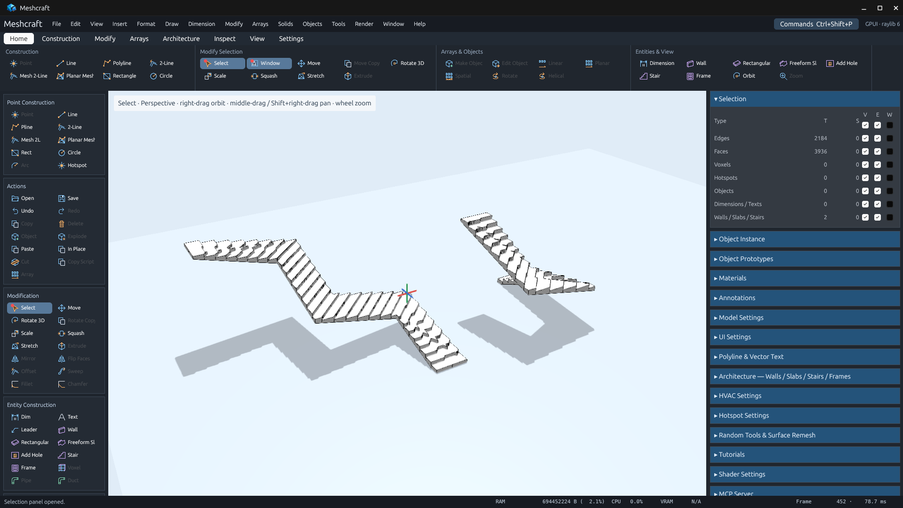
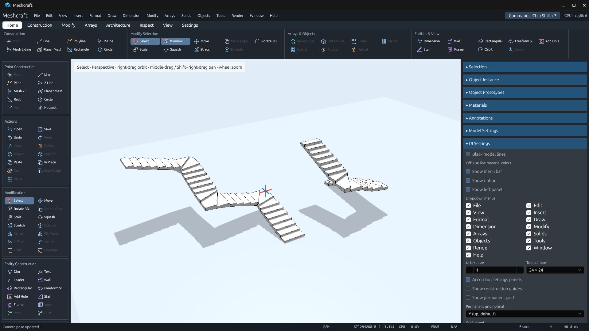

# Straight tread fronts on winding stairs

The previous generator interpolated a walking-progress scalar over footprint
triangles and clipped that scalar into steps. Its iso-lines changed direction
at triangulation seams, creating zigzagged tread fronts even on straight parts
of a winding stair.

The replacement clips the local footprint with one straight section per station.
The section is perpendicular to the walking tangent. Sharp turns use analytic
circular winders whose curvature center is on the inner contour; using sampled
arc chords here would make nearby sections intersect inside the stair. The
original path and contour remain the editable model inputs. Closely spaced
corners that cannot fit a valid winder fail explicitly. A final geometric check
rejects any intersecting-cut configuration that would make a front non-collinear.

Treads tile the contour once. Shared boundary coordinates are retained exactly,
with a conforming continuous underside and closed, oriented side/riser faces.
Extra collinear control points do not change the shape. Existing height, support
material, guide lines, copy/transform, save/open and control-point workflows remain.

## Native MCP comparison

The same [saved two-/three-turn project](multiple-turns.octd), originally created
through MCP in 0.45.1, was opened in the rebuilt 0.45.2 app. The inspection queries
real triangle/vertex records through `meshcraft_geometry`; it groups adjoining
horizontal tread boundaries and checks their collinearity and continuity.
The images below are unaltered app-window captures, not source-code inspection.

| Case | Before: triangles / bad fronts | After: triangles / bad fronts |
| --- | --- | --- |
| U-shaped, two turns, 22 steps | 1,628 / 21 | 344 / 0 |
| S-shaped, three turns, 30 steps | 2,308 / 14 | 464 / 0 |
| Total | 3,936 / 35 | 808 / 0 |

The after check covers all 50 internal fronts. It is a correctness check, not a
frame-rate benchmark. Results: [before](before-validation.json),
[after](native-validation.json), [MCP actions](mcp-actions.json).

| Before — 0.45.1 | After — 0.45.2 |
| --- | --- |
|  |  |

Reproduce with a built app:

```sh
python3 scripts/verify_stair_fronts.py
```

All evidence is stored here, outside Cargo's `target`. The private runtime cache
is ignored; no user desktop or user drawing was modified.

## Validation

- `cargo fmt --all --check`: passed.
- `cargo test -p meshcraft-core stair_ --locked -- --nocapture`: ten stair tests
  cover straight, L, U, three-turn S, sampled curves, reversed contour order, a boundary walking line,
  whole-footprint area, manifold orientation, redundant collinear points,
  guides, persistence, transforms and controls.
- `cargo test --workspace --locked`: 774 passed, 22 platform/GPU checks ignored by default.
- `cargo clippy --workspace --all-targets --locked -- -D warnings`: passed.
- `cargo build --locked -p meshcraft-desktop --bin meshcraft`: passed.
- `python3 scripts/verify_stair_fronts.py`: two native stairs, 50 straight
  continuous internal fronts, zero failures.

Command outputs are retained beside this document. Store scenes are separately
preserved in [the presentation capture folder](../../../../packaging/microsoft-store/captures/).
