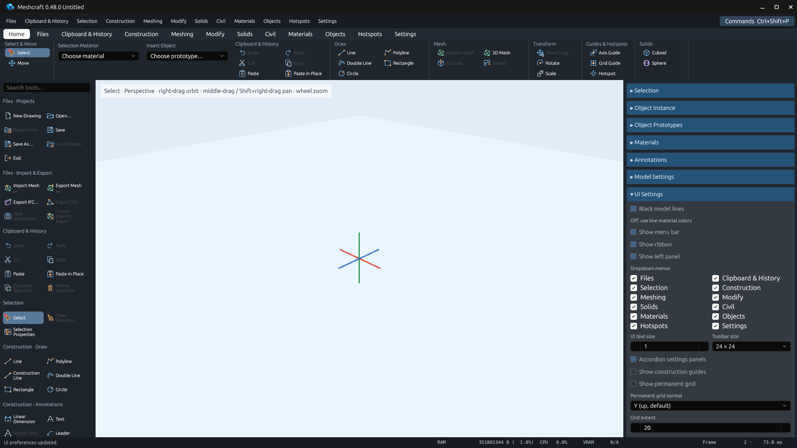
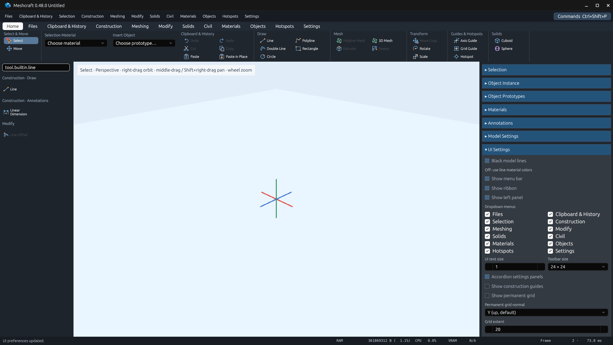
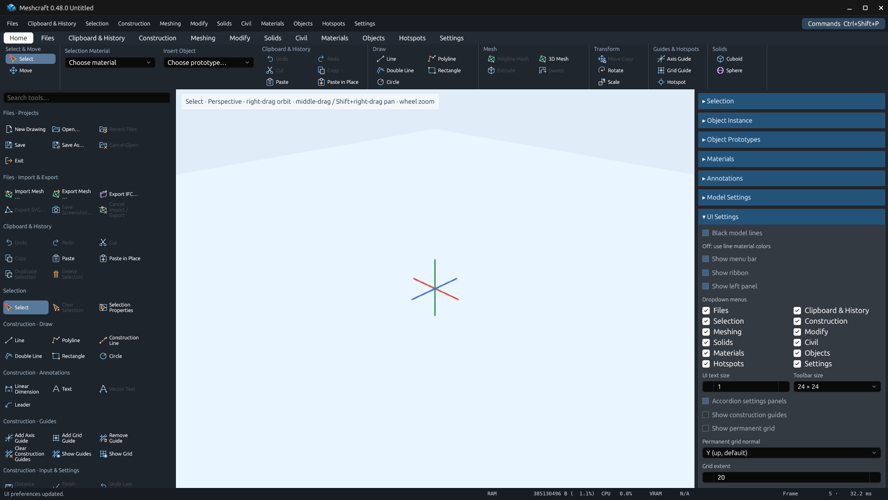
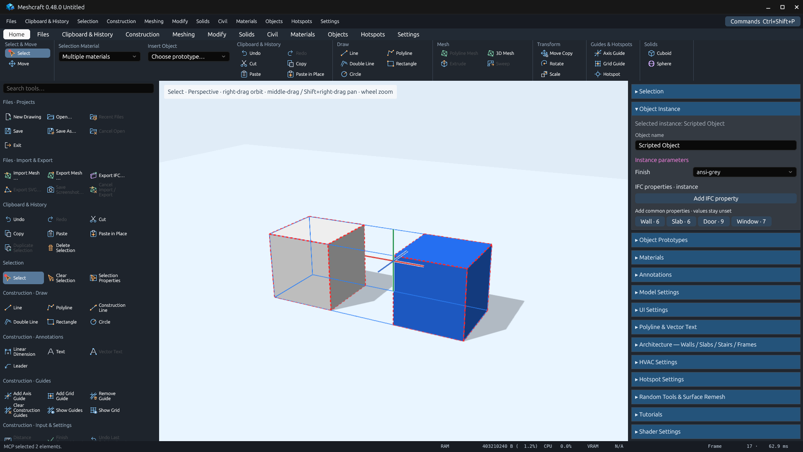
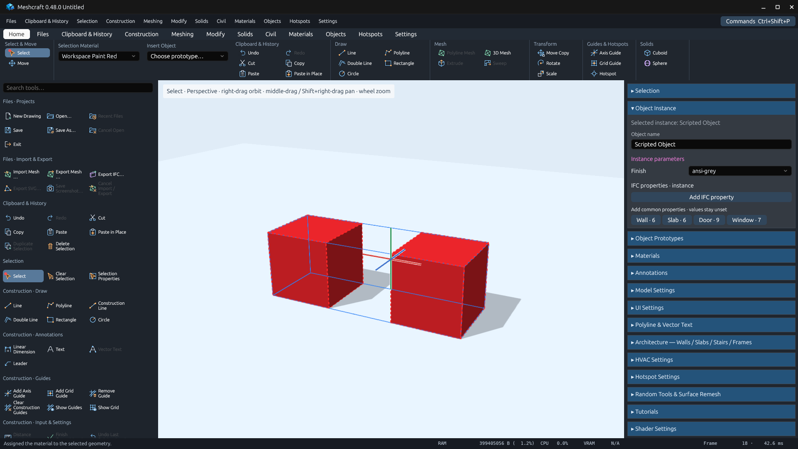
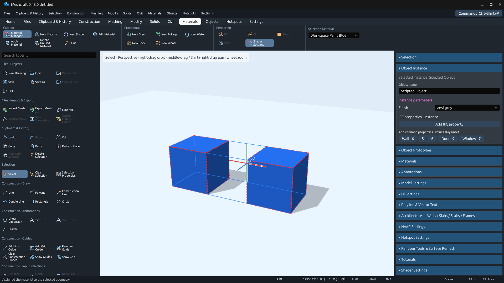
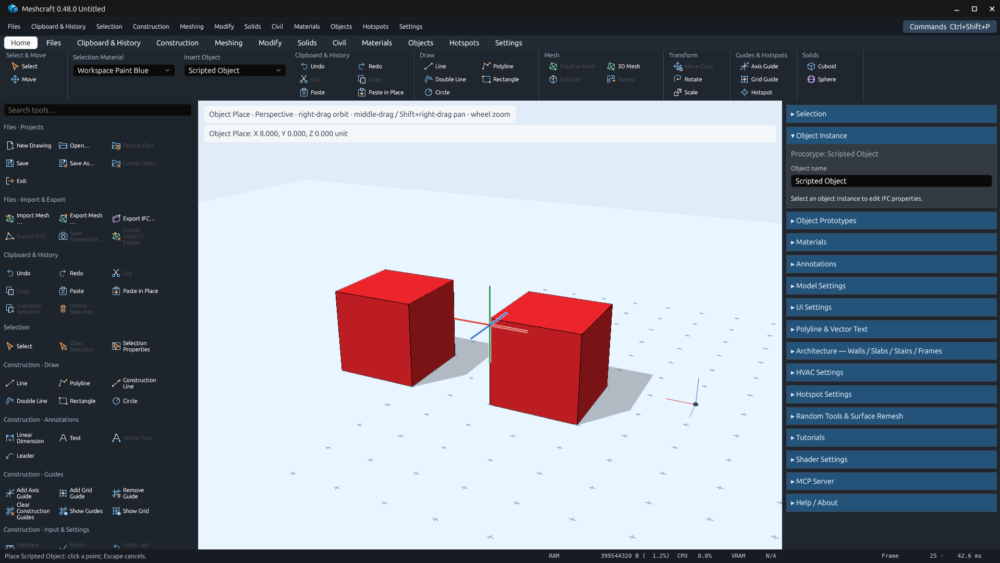
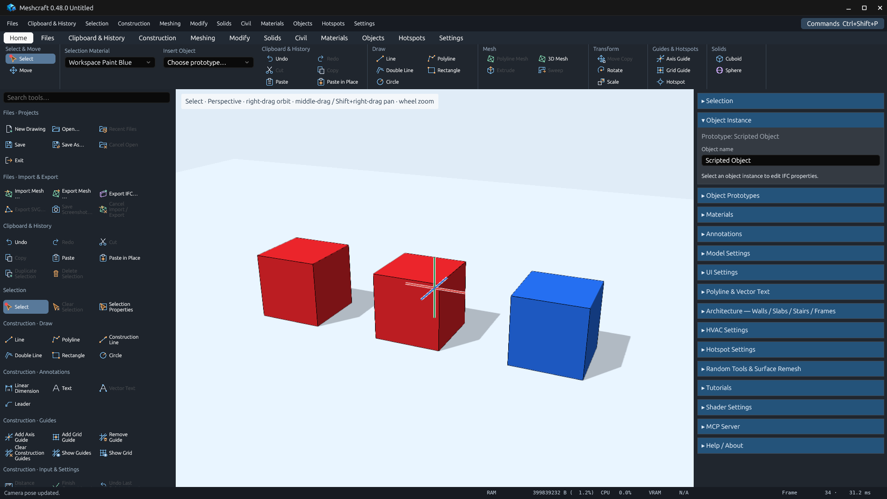

# Workspace controls and instance materials — 0.48.0

This handoff covers the searchable/resizable command shelf, Home and functional
ribbon projections, selection material switch, object insertion picker and
whole-instance painting. See [the user layout](../../../menu-layout.md).

## Native application verification

The actual GPUI application ran in an isolated 1920×1080 Linux Xvfb/Mesa desktop.
MCP created an independent scripted-box fixture and queried evaluated geometry;
native keyboard/pointer events operated the controls. No user drawing or running
desktop was changed. Screenshots are unaltered app-window captures.

- Shelf search filters sections and Enter executes a match. Escape clears search
  and returns focus to the viewport; command-palette keyboard operation remains valid.
- Dragging the shelf edge saves a width of approximately 380 logical pixels and
  resizes the physical viewport accordingly. Search/resize leave history unchanged.
- Home and Materials pickers show mixed/current finishes and assign both selected
  instances. One Undo reverts the complete selection; Redo restores it.
- The Home prototype picker starts floating insertion. Moving the wireframe
  changes no entity count; choosing its point adds one instance.
- Native Paint recolors the entire clicked script instance; sibling placements
  retain their finishes. Save/reopen preserves two red and one blue instances.
- Existing command-panel category search, arrow scrolling, Enter/mouse execution,
  shader preview and new/open/save-as title behavior pass their native regression run.

















Reproduce with a built executable:

```sh
python3 scripts/verify_workspace_controls.py --binary target/debug/meshcraft
python3 scripts/verify_functional_ui.py --output packaging/microsoft-store/captures/work/workspace-command-panel
```

The [recipe](../../../../scripts/verify_workspace_controls.py),
[native assertions](native-validation.json),
[command-panel regression report](command-panel-validation.json),
[capture receipts](capture-receipts.json), [MCP actions](mcp-actions.json), and
[saved fixture](workspace.octd) retain the evidence outside Cargo's target.
The paint duration is an end-to-end observation on this small software-rendered
fixture only; it does not represent the four-tier performance suite.

## Automated verification and implementation

[Validation commands/results](validation.txt) record 792 passing Rust tests,
22 ignored tests, clean formatting/Clippy, inventory/icon/Store checks and the
native runs. All 290 command IDs and all four user review columns are preserved.
No command was added or removed; registered stress-tool coverage is unchanged.

Tests cover ribbon placement, per-tab uniqueness, category/keyword shelf search,
viewport resizing at different DPIs, width preference persistence/rejection,
whole-object versus prototype-face painting, mixed geometry/architecture/instance
assignment in one Undo step, sibling isolation, copying, nested child defaults,
script/catalog updates, save/reopen and import material-ID collisions.

Instance finishes are metadata (`k3d.meshcraftInstanceMaterial`) rather than
persistent triangle/mesh replacements. Derived colored geometry is cached per
immutable snapshot and refreshed after geometry/material changes. Selection
material queries group primitive IDs by owner, scan shared geometry once, and
avoid scene traversal for selected leaf objects. Native Paint avoids the former
CPU face preview/picker during pointer movement.

An instance finish overrides emitted mesh finishes; per-part scripted material
parameters remain authored. Prototype editing still paints authored faces/edges.
GPU-generated shader objects retain their own shader settings; trying a surface
assignment gives an explicit instruction to use Shader Object Settings or bake
to mesh, rather than reporting a successful but invisible change.

All eight Store and stable README screenshot paths were refreshed from the saved
MCP demonstration projects. The [manifest](../../../screenshots/manifest.json)
records native capture versions and SHA-256 hashes.
