# Object prototypes, instances and dynamic hotspots

This is the user-confirmed object workflow, supplied with the 19 captures below on 2026-10-20. It refines F04/F09, I06/I07 and M26/M27; acceptance remains C07/C08/C15/C16. Source behavior is implemented in k3d's `GroupScene.kt`, `HotspotStore.kt`, `ObjectPlaceTool.kt` and the object/hotspot panel callbacks. Preserve source characterization separately from implementation verification.

## Prototypes and instances

A prototype is a reusable subscene: it owns lines, faces, hotspots, semantic entities and a hierarchy of other object instances, using the same scene capabilities as the root. An instance references that prototype and owns its placement plus per-instance hotspot values/overrides. Copying an instance preserves its current hotspot values; it does not turn the copy into a separate prototype. All instances continue to share definition edits while retaining their independent parameter values.

The **Object Prototypes** browser lists prototypes, once each, with name, internal/external status, occurrence count and identity. It must not list one row per instance. The separate **Object Instance** inspector describes the selected instance or the prototype being edited in place. Screenshot 01 shows the current instance-list deficiency; screenshots 02–19 are legacy workflow evidence.

Double-clicking a prototype row activates insertion of that definition, even when no existing instance is selected. The cursor shows the instance's wireframe placement feedback and uses ordinary point-input snapping and surface-glue rules. Accepted placement creates an instance in the active scene/subscene. Double-clicking a placed instance enters its shared prototype for editing in place.

Explode replaces the selected placement with its current resolved content in the
parent graph, including evaluated scripts and instance deformations. Mesh results
are ordinary editable primitives; do not create an automatic replacement object
or an “exploded” prototype. Repeating Explode on that mesh cannot allocate another
wrapper. Traversal must be bounded by the actual hierarchy, not viewport frames.

The Object Prototypes panel has an explicit **Delete Prototype** button, enabled
for the selected definition whether or not it has instances. An unused prototype
is deleted immediately. For a used prototype, show a warning naming it and
stating that **all its instances will be deleted**, including placements inside
other prototypes. Cancel (or Escape) leaves the drawing unchanged. Confirm removes
the definition and all its placements from the scene, retained parent prototypes,
and private instance layouts, as one undoable transaction. This works at any point
in the editing history. Remove descendant overrides whose paths no longer exist;
retain unrelated prototypes and geometry. A changed drawing invalidates an open
confirmation. Unowned stale layouts must not block deletion. A zero active-scene
instance count can still mean the definition is used by an unplaced parent prototype. Built-in windows and
doors use their architectural properties and are not implicitly user objects;
see [frame ownership](modeling.md#p03-stairs-window-frames-and-door-frames).

Import/prototype insertion prepares its wireframe once per source revision/context. Pointer
motion only updates the placement transform; it must not clone, insert or validate a temporary
scene on every move. The native renderer retains the uploaded wireframe between moves, including
when surface alignment changes. Clicking commits the complete geometry once; Escape releases
the preview without creating an instance.

## Metadata and prototype browser

The prototype browser uses left-aligned rows with a cached orthographic isometric
thumbnail. Create/update, shared parameter and material changes refresh the image;
camera movement and individual animation frames do not rebuild it. Scripted and
unplaced prototypes are evaluated in an isolated preview context.

Both panels manage complete IFC 4.3.2.0 property/quantity records: add, edit and
delete, with the full offline standard catalog and custom names. Prototype values
are creation defaults copied into each new instance, never live inherited fields.
Instance edits and deletions survive prototype edits, copy and Save/Open. This
applies to graphical and scripted prototypes. See [IFC properties](../../ifc-properties.md).

The panels also offer opt-in Wall/Slab/Door/Window Common starter subsets.
Applying one adds only absent fields with unset values and preserves existing
records. Instance batches are atomic and undoable. Prototype defaults still apply
only at creation. A preset selects property names, not an IFC class or inferred
performance values. Only assigned properties are shown in the panels.

## Editing isolation and navigation

Within prototype editing, selection and modification are limited to the active subscene's own geometry and immediate nested instances. Outside geometry stays visible, optionally faded, and remains a snapping/constraint reference. It is not selectable or modifiable. A nested instance can be entered to edit its definition in turn. Construction writes directly into the active prototype.

Pointer motion, snapping and individual picks must reuse the prepared prototype editing view,
rather than cloning the scene for every query. Rendering and spatial queries share that immutable
view until authored/evaluated geometry, document generation or the edit context changes.

Escape exits the active object-edit context and cancels its current draft; a dedicated Close Object/Exit Editing button provides the same one-handed action. Outside object editing, retain the established staged Escape behavior. Exit clears edit-context selection and restores instance-level interaction. The inspector must clearly distinguish selected instance, edited prototype and root scene.

## Hotspot authoring and instance behavior

Hotspots are scene elements and may be authored either in a prototype or directly at the root. A definition hotspot owns a stable ID, name, local anchor, operation, shape, RGBA color, optional reference point, attached geometry and optional attached hotspots. Supported operations are MOVE, SCALE, STRETCH, ROTATE, MULTIPLY_LINEAR, MULTIPLY_VOLUMETRIC, MULTIPLY_ROTATE_2D and MULTIPLY_ROTATE_3D. Shapes are TRIANGLE_UP, SQUARE, CIRCLE, DIAMOND and TRIANGLE_DOWN.

The author can place/select a hotspot, edit its properties, attach a mesh/entity selection, select attached geometry, pick or clear its reference, and delete it. Attach Selection uses the current supported geometry selection without requiring an object-only selection. Vertex/edge/face identity and connected geometry matter for stretch behavior. The reference is expressed in the owner's local frame and transformed for world-space snapping/input. Screenshot 10 displays STRETCH with a reference set; the user's description also cites move-type point input. Do not infer an operation from the screenshot caption alone.

At instance level, prototype hotspots appear with their configured shapes/colors only when one object instance is selected. Selecting its hotspot keeps that owner's handles visible during a drag. Zero/multiple object selections hide closed-instance handles and exclude them from hit testing. Root and active-prototype authored handles remain visible for authoring. Handle discovery must only evaluate eligible owners, rather than every instance on each pointer event. Dragging one invokes its configured operator on its attached content and previews both geometry and measurements. Each instance owns its hotspot targets independently. Recompute from immutable prototype content and that instance's values; repeated motion must not accumulate deformation. A geometry drag commits one undoable change; cancellation restores the initial values/geometry. Prototype geometry/bindings must remain unchanged by a runtime instance drag. Copy/array operations preserve the source instance's values. Editing the shared prototype propagates to all users without flattening their parameter state.

## External prototypes

A prototype may reference an external scene. That scene's root is used as a subscene, including its root hotspots and nested instances. Placement, instance-local values, copy and editing/isolation semantics remain explicit. Preserve source path/identity, missing-file diagnostics and a deliberate refresh workflow; loading or refreshing an external scene must not silently discard local instance values or recurse indefinitely through cyclic references.

Instance hotspot operations run with prototype editing **closed**. Editing mode authors the shared handle definitions: dragging repositions the marker without applying its operator; dragging a closed-instance handle changes only that instance’s values.

## Screenshot evidence

All original captures are retained. Captures 15/16 and 17/18/19 show repeated states and are not independent validation runs.

### Capture 01 — Current Meshcraft Objects panel (instance list to replace with prototype browser)

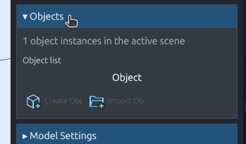

### Capture 02 — Legacy selected-instance inspector and prototype browser

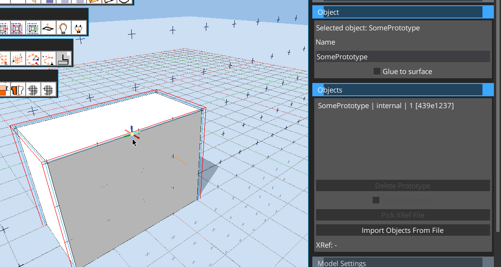

### Capture 03 — Legacy in-place prototype edit context

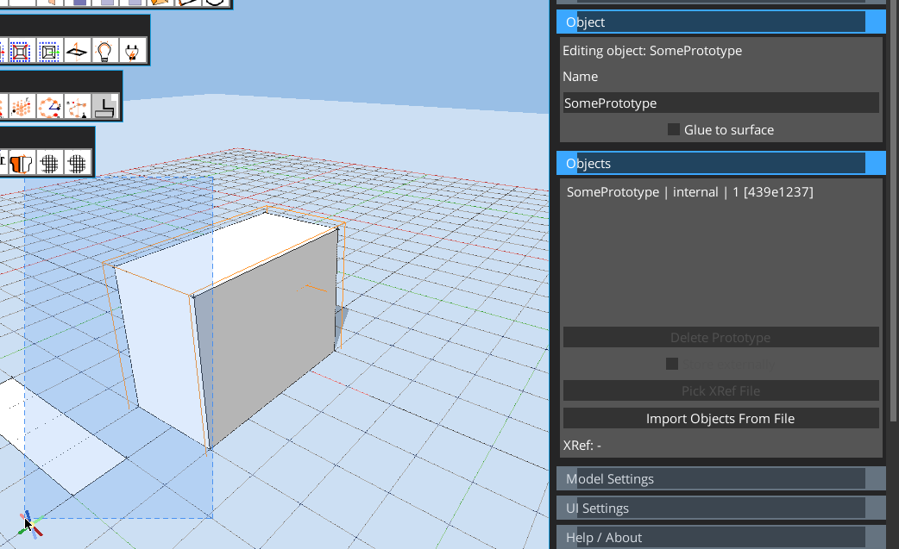

### Capture 04 — Selection confined to prototype geometry

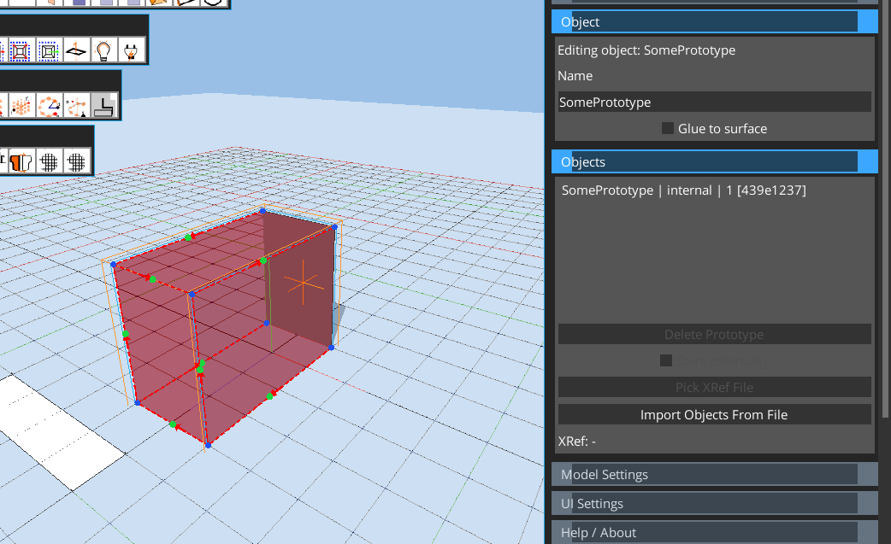

### Capture 05 — Hotspot authored at a prototype corner

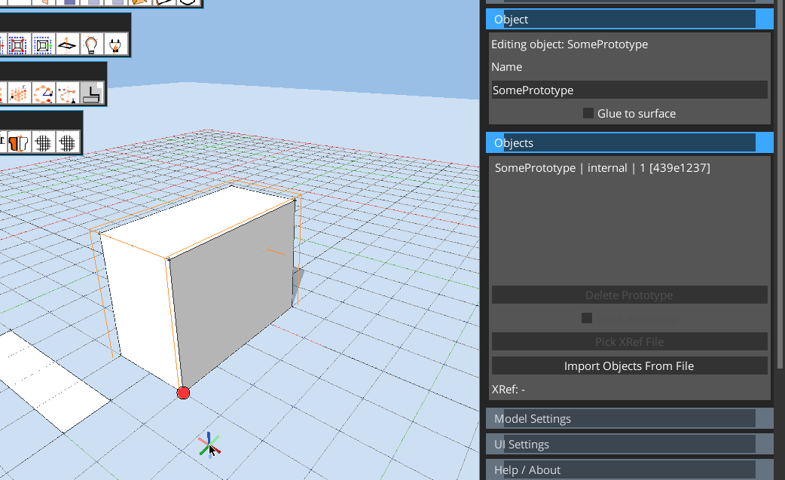

### Capture 06 — Window selection of the hotspot

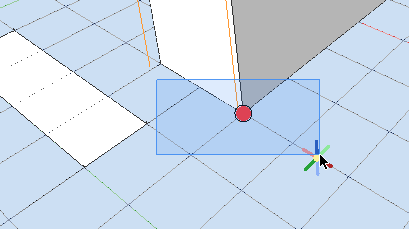

### Capture 07 — Hotspot operation choices

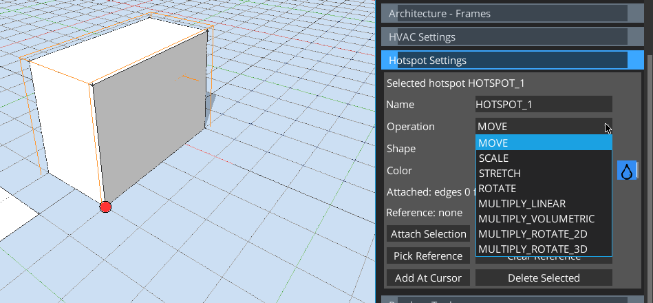

### Capture 08 — Hotspot shape choices

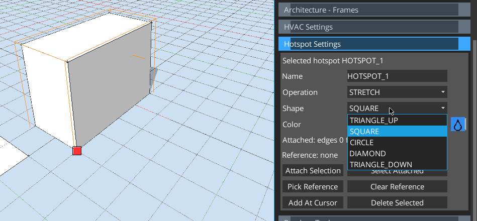

### Capture 09 — RGBA hotspot color editor

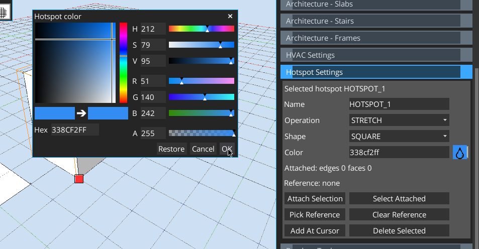

### Capture 10 — Hotspot reference set (STRETCH shown)

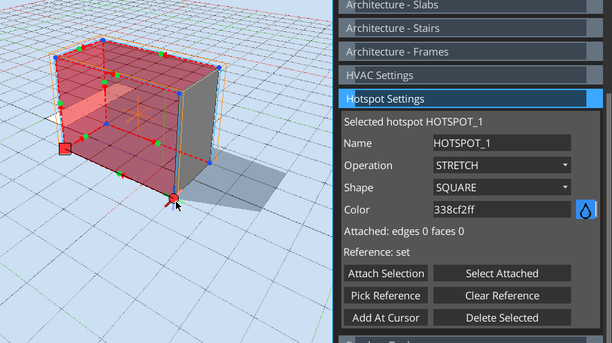

### Capture 11 — Instance-level square and circular handles after leaving edit mode

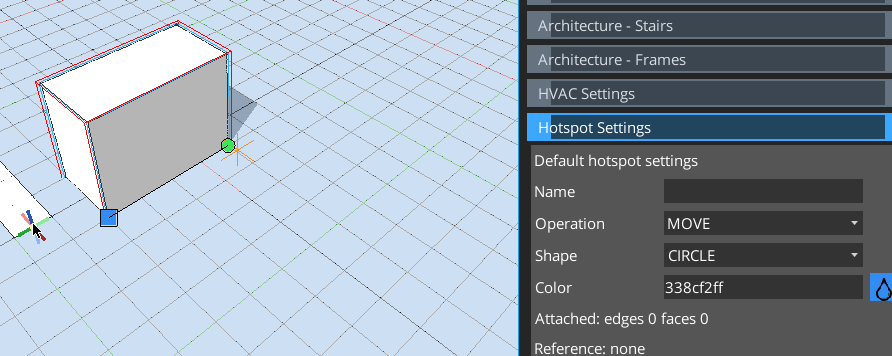

### Capture 12 — Wireframe array preview carrying instance handles

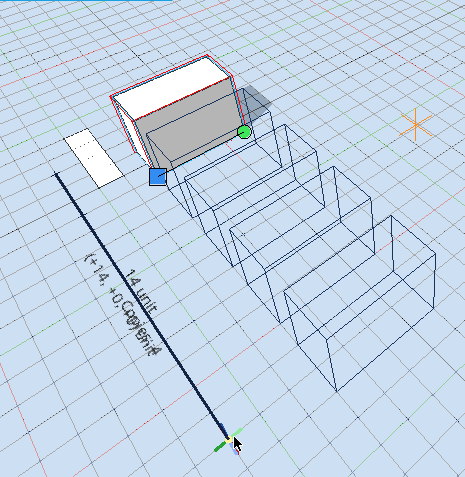

### Capture 13 — Copied/arrayed instances with hotspot values

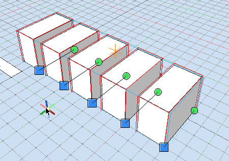

### Capture 14 — Attaching the selected face region to a hotspot

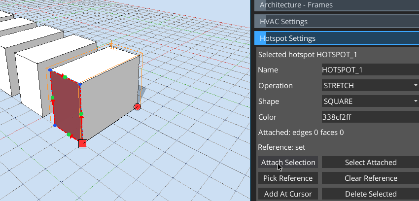

### Capture 15 — Runtime hotspot drag preview and attached-content count

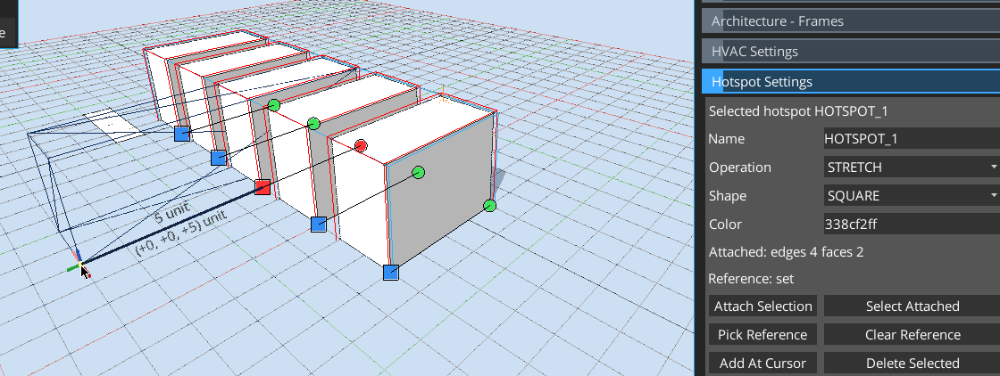

### Capture 16 — Repeated capture of runtime hotspot drag preview

### Capture 17 — Independent deformed instance shapes sharing one prototype

### Capture 18 — Repeated independent-instance result capture

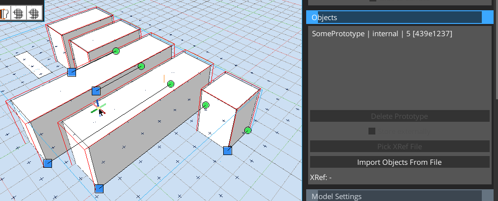

### Capture 19 — Repeated independent-instance result capture

## Meshcraft implementation evidence (2026-10-20)

The following are live Meshcraft GPUI captures, separate from the user-provided legacy evidence above. The offscreen raylib viewport remains an ordinary GPUI image. These checks used Linux X11/Xvfb with software Vulkan; they are interaction checks, not hardware frame-rate qualification. See [the validation record](../handoffs/object-workflow-validation.md) for exact automated commands and remaining acceptance scope.

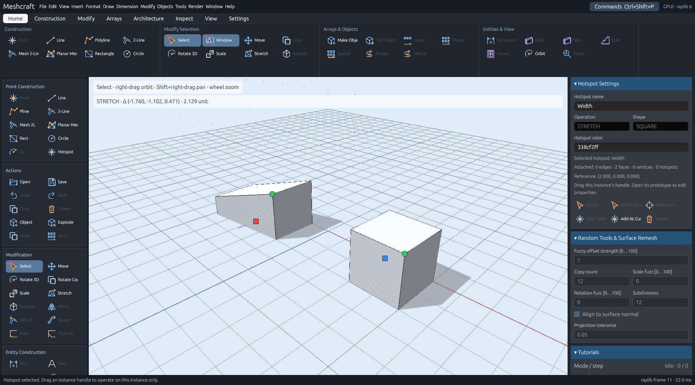

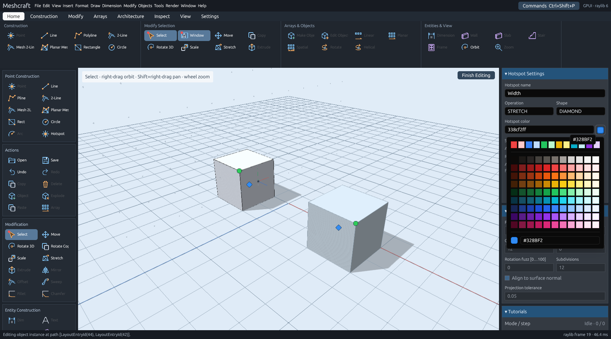

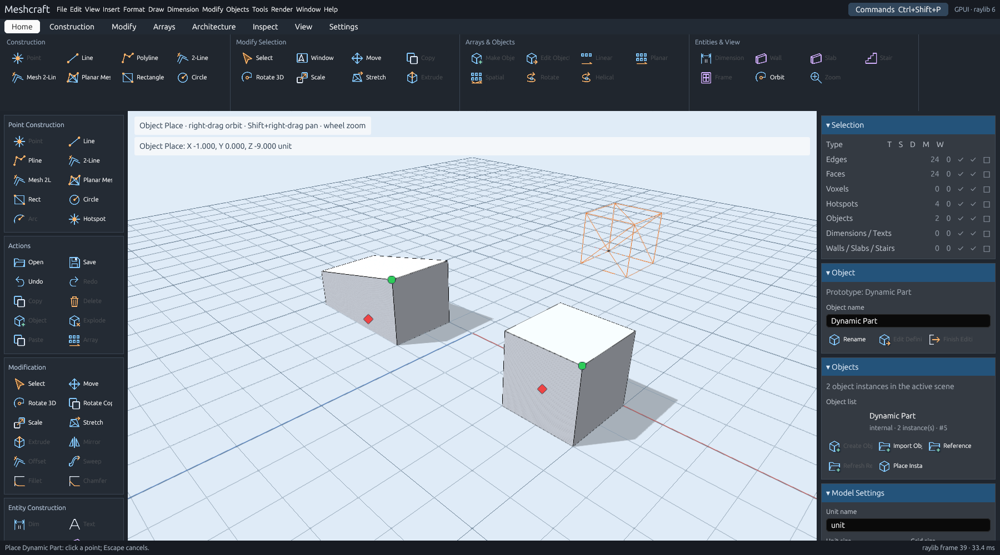

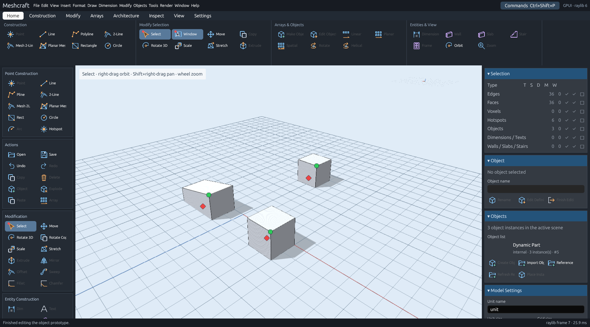

Scripted configuration points augment this workflow; see [scripted objects](scripted-objects.md). Materials use the [project catalog](materials.md).

### Batch inspector properties — 2026-10-22

Hotspot metadata fields (name, operation, shape and color) apply to all selected
hotspot definitions that can be authored in the active context. Preserve every
hotspot's own position, attached geometry and reference point. Validate and undo
multi-field/multi-hotspot edits as one transaction. This does not change the
per-instance operator values or the rule that instance operations happen outside
prototype editing.

The object-name inspector renames each distinct selected object prototype once,
in one undoable edit. While editing a prototype it continues to name the active
prototype. Unselected prototypes retain their names; shared definitions retain
shared naming semantics.
