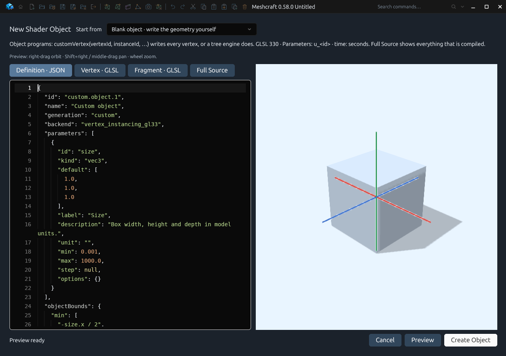
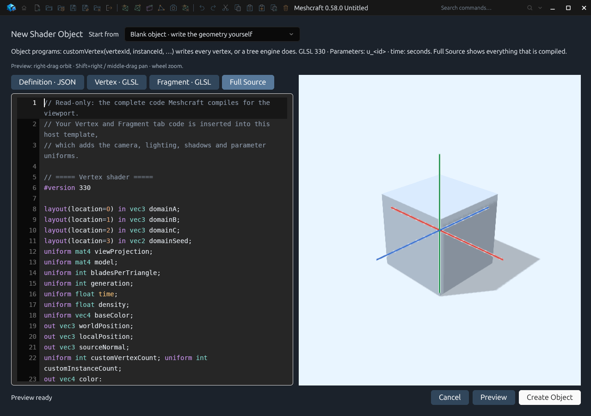
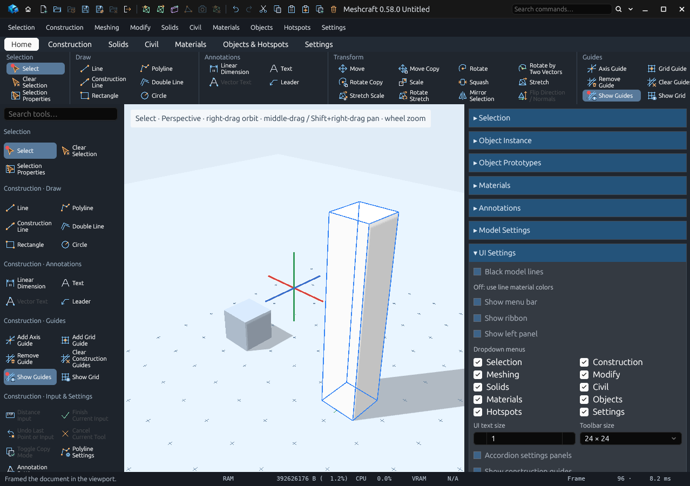

# Shader objects from scratch (T82)

A shader object is an object whose geometry is written in GLSL and generated on
the GPU every frame. Nothing is stored as mesh: the drawing keeps the program and
the object's parameter values. Since 0.58.0 you can write one from the ground up,
and see every line of code that Meshcraft compiles around yours.



## Create one

1. Choose **Objects › New Shader Object**. The shader editor opens on a blank
   object: a box written in about fifteen lines of GLSL, previewed on the GPU.
2. Edit the **Definition**, **Vertex** and **Fragment** tabs. The preview updates
   after a short pause in typing. Compiler errors appear below the panes.
3. Press **Create Object**. The program and a new prototype are saved as one Undo
   step, and placement starts: click where the object goes.

**Start from** offers other starting points: a blank surface program, or any
built-in (Tree, Branching fractal, Grass, Foliage, Water, Brick, Wood). Creating
an object from an unchanged built-in uses the built-in program itself, so a tree
is still New Shader Object › Branching fractal › Create Object. Edit its code and
it is saved as a custom copy with a new ID; the built-ins never change. Choosing a
surface starting point turns the button back into **Save Program**, because a
surface program shades existing faces and isn't an object by itself.

**Materials › New Shader** opens the same editor, starting from a blank surface,
and only saves the program.

**Shader Object Settings** edits a selected object's parameters, colour and
budget. Its **Edit Program / Parameter Schema** button reopens the program.

## Nothing is hidden: Full Source

The **Full Source** tab shows the complete vertex and fragment shaders exactly as
they are compiled for the viewport, with your code in place. It is read-only, and
you can select and copy from it.



The host template around your code does four things: it transforms your local
positions by the object's placement and the camera, lights the surface with the
scene light and shadows, declares one uniform per parameter, and applies the
material's base texture. Built-in tree programs also include their tree engine,
which you can read there too; a blank object contains none of it.

## The vertex function

```glsl
void customVertex(int vertexId, int instanceId,
                  out vec3 position, out vec3 normal, out vec2 uv)
```

It runs once per vertex. Every three consecutive vertices form a triangle; the
winding is kept when the object is baked, so emit corners counter-clockwise as
seen from outside. `vertexId` counts from 0 to `vertexCount - 1` within one
instance, and `instanceId` from 0 to the instance count minus one. Positions and
normals are in the object's local space, in model units.

Also available: `u_<id>` for each parameter, `time` in seconds,
`customVertexCount` and `customInstanceCount`. Two optional hooks run after it:
`proceduralVertex(inout vec3 position, inout vec3 normal, vec2 uv)` in the Vertex
tab, and `vec4 proceduralColor(vec4 color, vec3 position, vec3 normal, vec2 uv)` in
the Fragment tab, where `color` is the object's material colour and position and
normal are in world space. Leave either out to keep the defaults.

## The definition

```json
{
  "id": "custom.stack",
  "name": "Box stack",
  "generation": "custom",
  "vertexCount": 36,
  "instances": "count",
  "objectBounds": {
    "min": ["-size.x / 2", 0, "-size.z / 2"],
    "max": ["size.x / 2", "count * size.y", "size.z / 2"]
  },
  "parameters": [
    {"id": "size", "kind": "vec3", "default": [1, 1, 1], "label": "Size", "min": 0.001},
    {"id": "count", "kind": "integer", "default": 4, "label": "Boxes", "min": 0, "max": 64}
  ]
}
```

| Field | Meaning |
| --- | --- |
| `generation` | `custom` for an object you write yourself. |
| `vertexCount` | Vertices per instance: a multiple of 3, from 3 to 65,536. |
| `instances` | A whole number from 1 to 1,000,000, or the ID of an `integer` or `unsigned` parameter. Default 1. |
| `objectBounds` | The local box that encloses everything the object can emit. Required. |
| `boundsExpansion` | Extra margin added to every side of the bounds. |
| `animated` | Redraw continuously, for code that uses `time`. |
| `transparent` | Blend fragments whose colour alpha is below 1. |

Parameters use the same kinds and controls as material programs: float, integer,
unsigned, seed, Boolean, vectors, colour, matrix, texture and enum.

### Bounds follow the parameters

Meshcraft uses `objectBounds` for culling, picking, the selection box, Fit Model
and the settings preview, without running your shader. Each coordinate is a
number or an expression over parameter values: `+ - * /`, parentheses,
`min(a, b, …)`, `max(a, b, …)`, `abs(a)`, and vector components such as
`size.x` (also `.r .g .b .a`). Booleans read as 0 or 1. In the example above the
box grows with `count`, so Fit Model frames the whole stack.



Keep the bounds honest. Geometry outside them may be culled when the bounds leave
the screen, and can't be picked there. With the default values, `min` must not
exceed `max`; for other values the corners are ordered for you.

## Limits

- The object's **Candidate budget** (in Shader Object Settings, default 50,000)
  caps the instances drawn, and so does a total of 6,000,000 vertices per object.
  Instances beyond either limit are not drawn.
- A count of zero draws nothing; baking it reports an error instead of making an
  empty mesh.
- OpenGL 3.3 vertex shaders only: no geometry, compute or mesh shaders.
- Generated geometry can't be snapped to, exported or edited until it is baked.

## Baking

- **Bake to Mesh** captures what the GPU emits, at full detail, as editable edges
  and triangles. Shader colours become face colours.
- **Bake to GPU Mesh** (formerly *Bake to Shader*) freezes the evaluated object as a
  static mesh drawn by the shared mesh renderer. It doesn't keep the program.
  The command ID is still `object.bake_to_shader`.

Both are single Undo steps and leave other instances of the prototype unchanged.

## From MCP

`material.program` saves a program (`{"program": {…}}`), and
`object.configure_procedural` with `settings.procedural.program` set to its ID
creates the object and starts placement. `meshcraft_capture_view` reports
`procedural.diagnostics` and candidate counts. See [the MCP guide](mcp.md#procedural-materials-30).

Validation: `python3 scripts/verify_shader_objects.py` drives all of the above in
the real application; [T82](rewrite/handoffs/T82.md) records the results.
