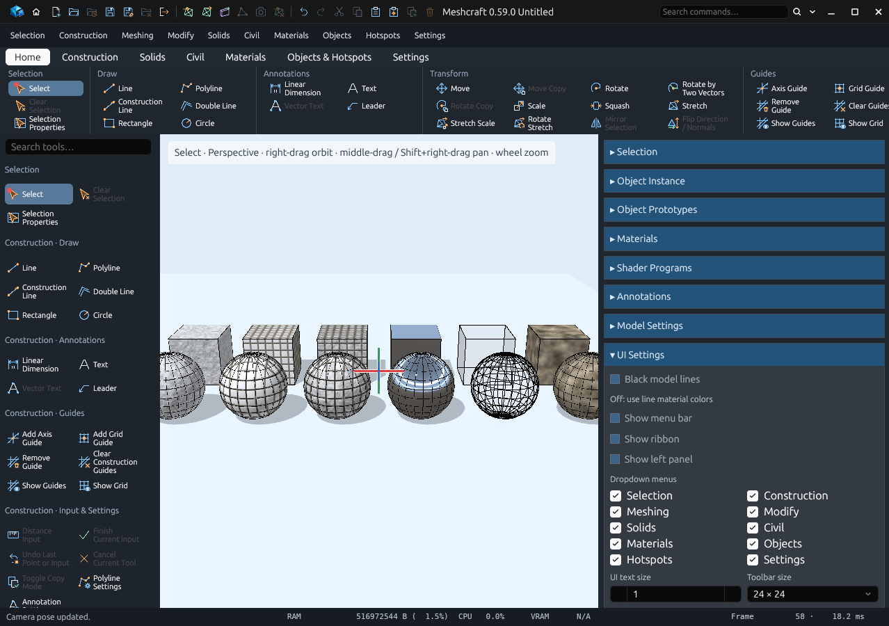
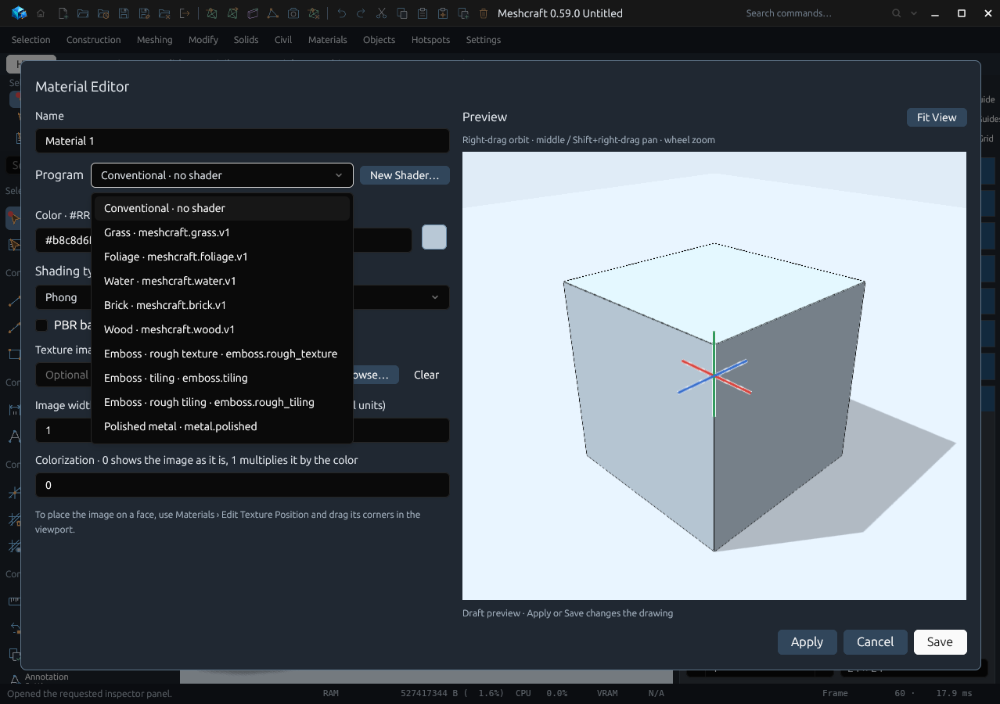
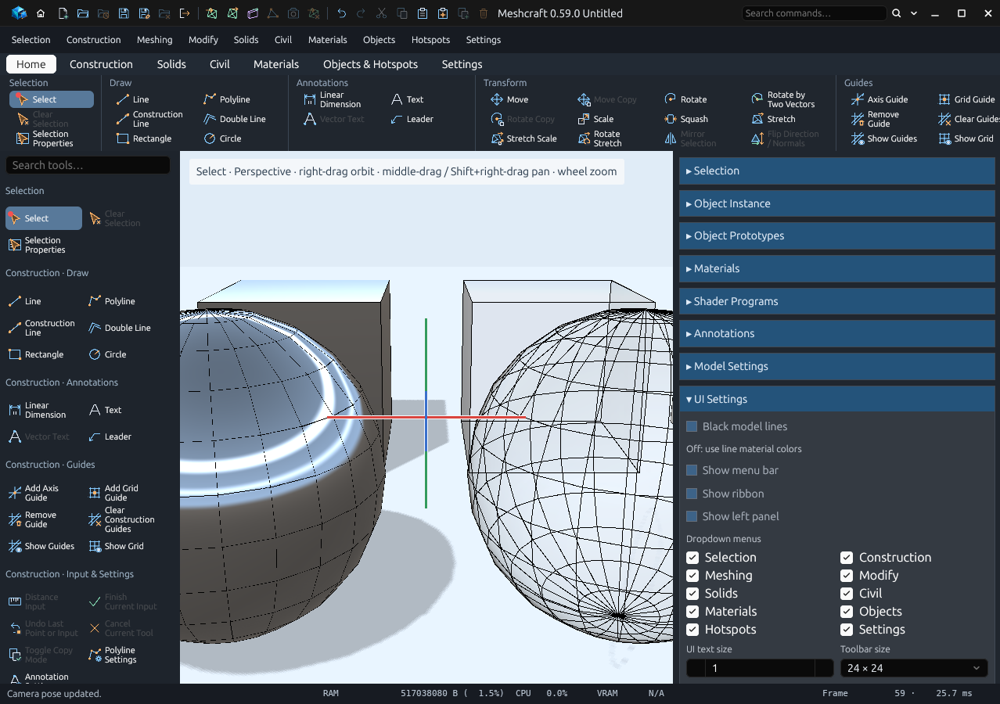
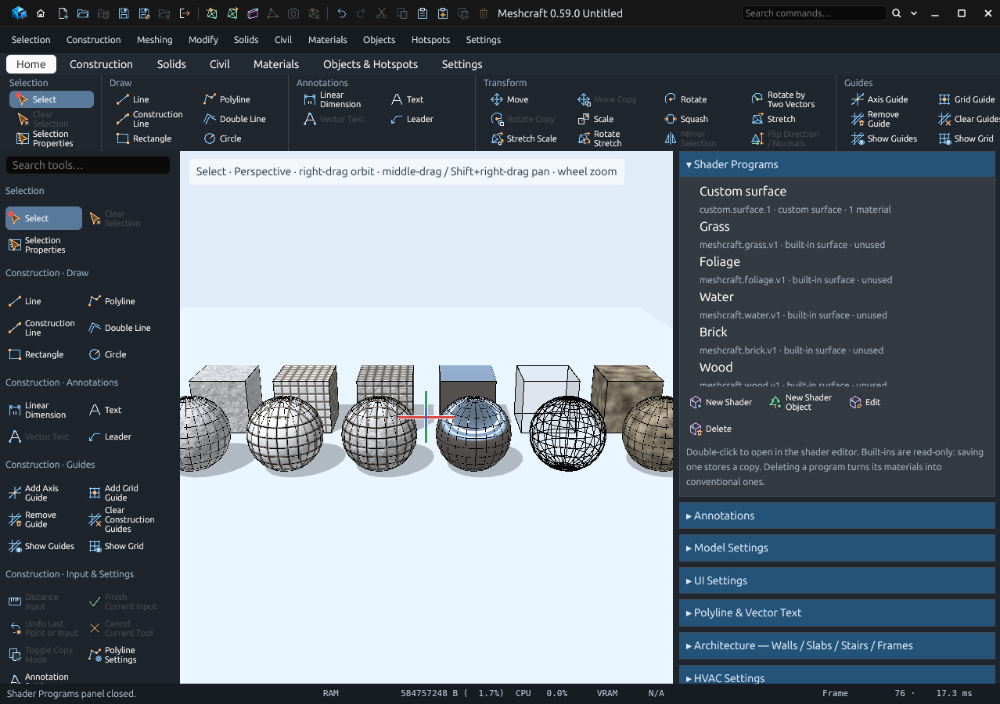

# Standard shaders and the Shader Programs panel (T83)

Since 0.59.0 Meshcraft includes six more built-in surface shaders, one **New
Material** command for every shader, and a **Shader Programs** panel to manage
them. All of these shaders change how existing faces are shaded. Relief is
lighting only: edges, silhouettes, picking, snapping, export and baking still
use the flat faces.



From left: rough texture, tiling, rough tiling, polished metal, glass, Perlin noise.

## Use one

1. Choose **Materials › New Material**.
2. In **Program**, pick a shader, for example *Polished metal · metal.polished*.
   A new material also takes the shader's suggested name, colour and PBR settings.
3. Adjust the parameters, then **Save**.
4. Select faces or a solid and press **Apply to Selection**.



The material colour still matters: the emboss shaders use it for the surface,
metal tints its reflections with it, glass is tinted by it, and Perlin noise
multiplies its two colours by it.

## The shaders

| ID | Name | What it does | Main parameters |
| --- | --- | --- | --- |
| `emboss.rough_texture` | Emboss · rough texture | Fractal noise relief, like stucco or cast metal | Grain size, roughness depth, darken hollows |
| `emboss.tiling` | Emboss · tiling | Raised tiles with bevelled grooves on each face's dominant plane | Tile width/height, groove and bevel width, tile depth, row offset, variation, groove colour, rotation |
| `emboss.rough_tiling` | Emboss · rough tiling | Both: rough tiles in rough grooves | All of the above |
| `metal.polished` | Polished metal | Mirrors a studio environment (sky, light strips, horizon, ground, the scene light as a sun), tinted by the material colour | Reflectivity, polish (satin to mirror), sky and ground colours |
| `glass.clear` | Glass | See-through head-on, reflective and more opaque at grazing angles | Opacity, reflectivity, polish, sky and ground colours |
| `noise.perlin` | Perlin noise | Classic 3D Perlin noise in layers, blended between two colours, with optional relief | Feature size, octaves (1–8), contrast, low and high colours, relief, seed |

Patterns are sampled in the surface's own coordinates, so they move and rotate
with the object. Lengths are local model units.

**Cost.** The emboss shaders evaluate four noise layers per pixel; rough tiling
twice that. Perlin noise costs one noise evaluation per octave, two when relief is
on; four octaves is the default. Metal and glass are a handful of arithmetic
operations per pixel. All of them are fine for interactive use on ordinary scenes.



**Limits.** Metal and glass reflect a built-in environment, not the other objects
in the scene, and glass doesn't refract. Glass is drawn blended: only its nearly
opaque edges cast a faint shadow.

## Smooth shading on curved surfaces

Surface shaders now shade curved meshes smoothly. Where neighbouring faces meet at
less than 40°, the normal is blended across the edge. Sharper edges, such as box
corners, stay crisp. Mirror-like shaders need this. Before 0.59.0 a sphere showed
every facet in its reflection. The existing brick, wood and water shaders benefit
too. The geometry itself is unchanged.

## Write a new shader for a material

Press **New Shader…** next to the Program list. The shader editor opens on a blank
surface. **Save Program** stores it and returns to the material with the new
program chosen; **Cancel** returns with nothing changed.

The New Grass, New Foliage, New Water, New Brick and New Wood buttons were
removed: pick those programs in New Material instead. Their command IDs
(`material.new_grass` …) still work over MCP and in the command palette.

## Shader Programs panel

**Materials › Shader Programs** (or the panel of the same name on the right) lists
every program: your own first, then the built-ins. Each row shows the ID, whether
it is built-in or custom, surface or object, and what uses it.



- **New Shader** and **New Shader Object** open the shader editor.
- **Edit**, or double-click a row, opens the program. Built-ins open unchanged and
  stay read-only: saving one stores a custom copy under a new ID.
- **Delete** removes a custom program as one Undo step. Materials that used it
  become conventional materials and keep their colour, texture and PBR settings;
  the status bar names them. Built-ins can't be deleted. A program that shader
  objects still generate from is kept and the status says how many use it:
  delete or bake those objects first.

## Writing your own lighting: `proceduralLighting`

Metal and glass use a new optional fragment hook, available to every program:

```glsl
vec3 proceduralLighting(vec3 lit, vec4 color, vec3 position, vec3 normal)
```

It runs after Meshcraft has lit the surface with the scene light, ambient light
and shadows. `lit` is that result, `color` is what `proceduralColor` returned, and
`position` and `normal` are in world space. Return the final colour, for example
to add reflections or emission. The uniforms `eye` (camera position) and
`towardLight` are available. Leave it out to keep the normal lighting.

The full set of fragment hooks, in the order they run: `proceduralShadingNormal`
(relief), `proceduralColor` (colour and opacity), `proceduralLighting` (final
colour). The **Full Source** tab shows exactly where each one is called.

## From MCP

- Save a material with `material.save` and
  `procedural.program` set to one of the IDs above, then `material.apply`.
- `program.edit {"id": …}` opens a program in the shader editor.
- `program.delete {"id": …}` deletes a custom program.

Validation: `python3 scripts/verify_shader_library.py` drives all of the above in
the real application; [T83](rewrite/handoffs/T83.md) records the results.
