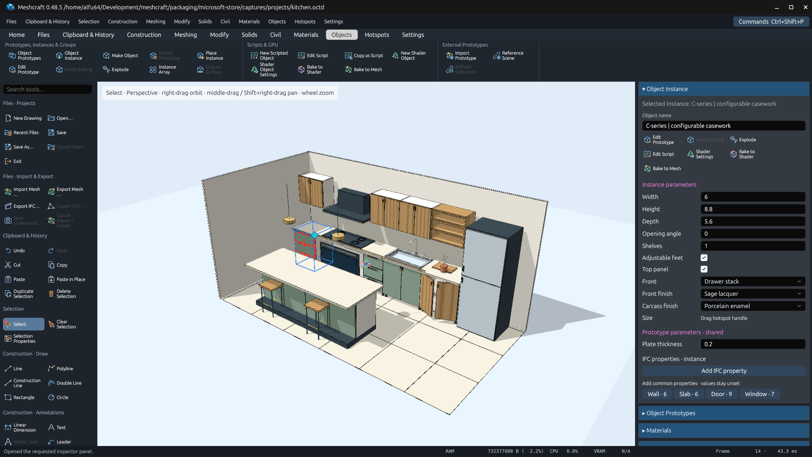
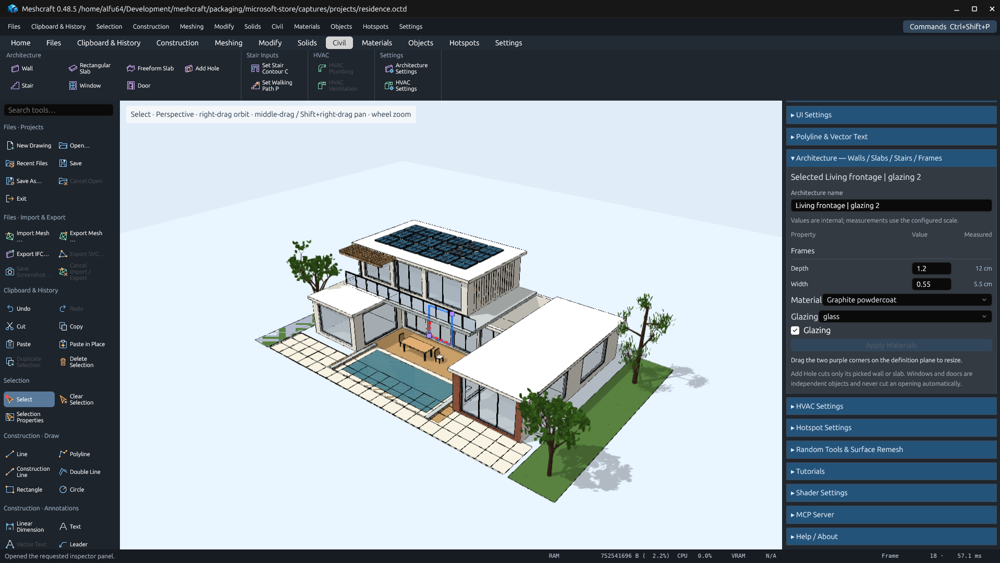
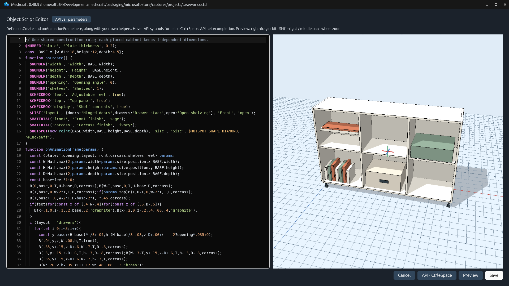
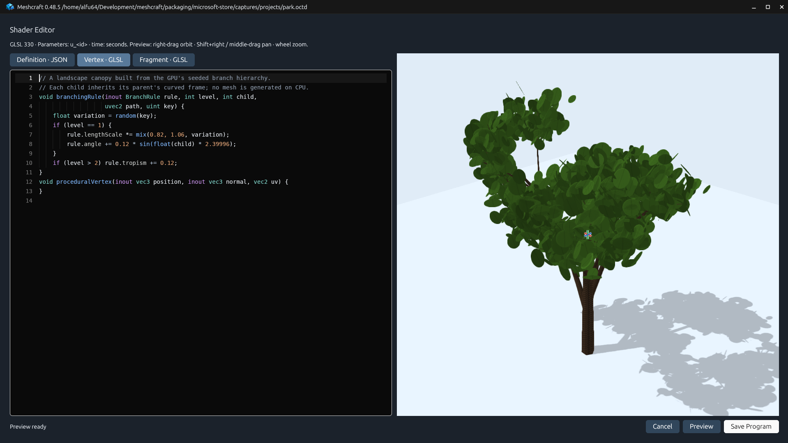
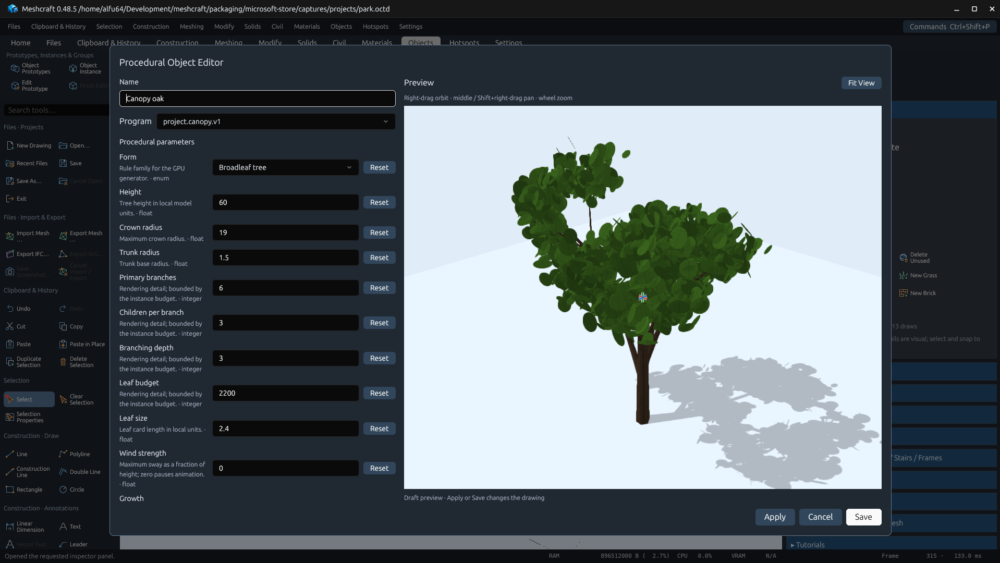
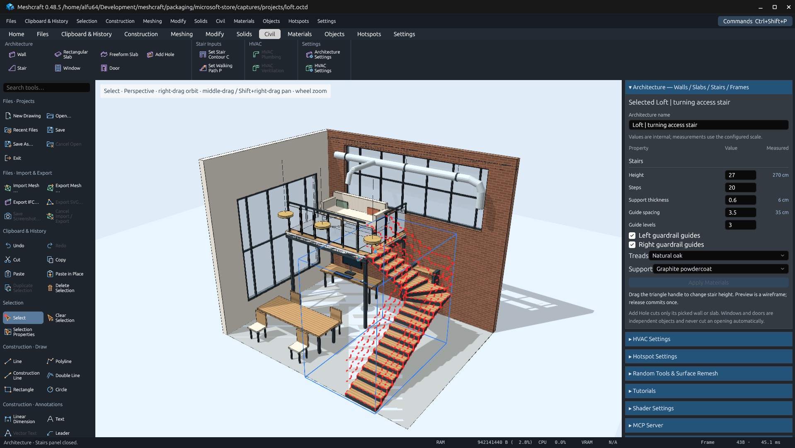
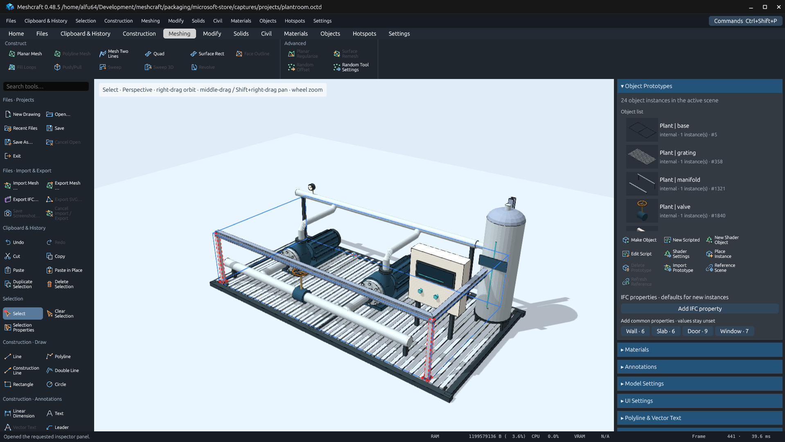
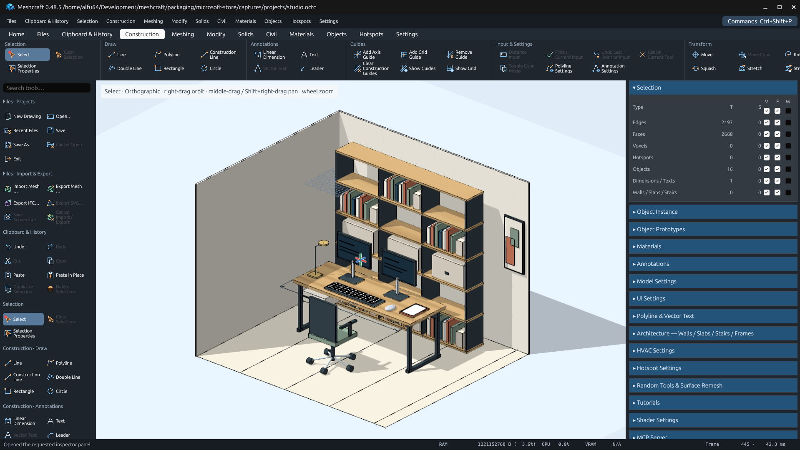

# Meshcraft-desktop — English Store listing

Direct 3D mesh modeling, reusable dynamic objects and live JavaScript/GLSL previews. Build architectural studies, explore procedural materials, and connect compatible agents through optional local MCP tools.

## Description

Shape your ideas in 3D, make them reusable, and bring them to life with code.

Meshcraft-desktop is a free, open-source direct mesh modeler for designers, makers and developers. Work directly with edges and faces in an interactive viewport, from a first outline to a detailed model.

Draw lines, curved paths, circles and surfaces. Build volume with extrusion, sweeps and revolve, then move, rotate, scale, stretch, mirror or combine geometry. Snapping, aligned guides and numerical input help you work precisely.

Turn geometry into reusable object prototypes and place independent instances. Drag configured handles to vary an instance, or edit the shared prototype. Build architectural studies with walls, slabs, openings, windows, doors and stairs.

Explore colors, transparency and procedural GPU materials, including grass, foliage, water, brick and wood. Create shader-generated trees and branching forms with editable parameters.

Develop JavaScript objects and GLSL shaders in editors with live 3D previews. An optional local MCP server lets compatible agents inspect and edit the model through documented commands and scripting APIs. External agent clients and services are separate.

Add dimensions, text and leaders; inspect designs with perspective, orthographic and walkthrough cameras. Exchange geometry in formats including OBJ, STL and glTF/GLB, and keep editable projects with Undo and Redo. Format support covers documented subsets rather than complete CAD or BIM compatibility.

Core modeling works offline. No Meshcraft account is required. The application interface is currently in English. Meshcraft is under active development.

## Features

- Direct 3D mesh editing with extrusion, sweeps, revolve and solid operations
- Precise snapping, aligned guides, numerical input and transformation previews
- Reusable object prototypes and independent instances with dynamic handles
- Walls, slabs, openings, windows, doors and editable architectural stairs
- Colors, transparency and procedural grass, foliage, water, brick and wood
- Shader-generated trees and branching forms with editable parameters
- JavaScript object editor with API discovery and a live 3D preview
- GLSL shader editor and optional local MCP server for compatible agents
- Dimensions, text, leaders and perspective, orthographic and walkthrough cameras
- Geometry exchange, editable projects, Undo/Redo and conversion between GPU objects and meshes

## Search terms

3D modeling, mesh editor, CAD, dynamic objects, JavaScript, architecture, procedural materials

## Screenshots

Build and reshape geometry directly in the 3D modeling workspace.

Reuse object prototypes and vary independent instances with editable parameters.

Create architectural forms, including walls, slabs, openings and stairs.

Write JavaScript objects with code completion and an interactive 3D preview.

Edit GLSL shaders beside a live preview of the material or object.

Explore procedural GPU materials, including foliage, water, brick and wood.

Adjust shader-generated trees and branching forms in the object settings preview.

Inspect architectural stairs and configure steps, supports and guardrail guides.

Build a mechanical assembly with pumps, pipework and a spatially swept structural profile.

Plan a furnished workspace with dimension annotations and an orthographic camera.
